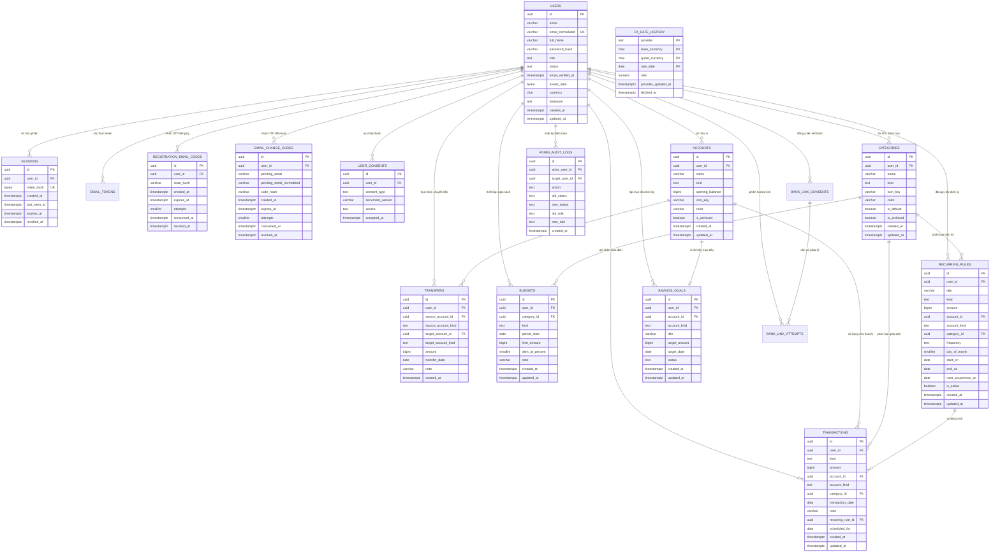

# Thiết Kế Cơ Sở Dữ Liệu (Database Design Document)
## Dự án: Hệ Thống Quản Lý Chi Tiêu Cá Nhân — "Ví Mình"

---

## 1. Tổng quan Kiến trúc Cơ sở Dữ liệu

Hệ thống sử dụng hệ quản trị cơ sở dữ liệu quan hệ **PostgreSQL 18** (chuẩn ACID) nhằm đảm bảo tính toàn vẹn dữ liệu, hiệu năng cao và độ tin cậy tuyệt đối cho các nghiệp vụ tài chính.

### 1.1. Các Nguyên tắc Thiết kế Cốt lõi
1. **Kiến trúc Đa người dùng Cánh ly Triệt để (Multi-Tenant Isolation):**
   - Mọi bảng dữ liệu tài chính nghiệp vụ đều có khóa ngoại `user_id` liên kết trực tiếp tới bảng `users(id) ON DELETE CASCADE`.
   - Sử dụng **Composite Unique Constraints** và **Composite Foreign Keys** dạng `(id, user_id)` hoặc `(id, user_id, kind)` để ngăn chặn triệt để tình trạng liên kết chéo dữ liệu giữa các người dùng ngay cả khi logic API có sơ suất.
2. **Đơn vị Tiền tệ Chuẩn hóa:**
   - Số tiền được lưu trữ dưới kiểu số nguyên dương lớn `BIGINT` tính theo đơn vị Đồng Việt Nam (**VND**).
   - `users.currency` chỉ là đơn vị nhập/hiển thị (`VND` hoặc `USD`); API quy đổi USD ở backend trước khi ghi, nên không có dữ liệu ledger ngoại tệ.
   - Tỷ giá USD/VND dùng làm tham khảo hằng ngày và được lưu trong bảng dùng chung `fx_rate_history`; VND → USD là nghịch đảo của cùng tỷ giá.
   - Tuyệt đối không sử dụng kiểu dữ liệu số thực (`REAL`, `FLOAT`, `DOUBLE PRECISION`) cho tiền tệ nhằm tránh lỗi làm tròn dấu phẩy động trong kế toán.
   - Ràng buộc kiểm tra `CHECK (amount > 0)` được áp dụng cho mọi giao dịch.
3. **Quy tắc Tính toán Số dư Động (Dynamic Balance Re-computation):**
   - Số dư của ví/tài khoản không lưu lặp lại ở dạng cột cố định để tránh lệch dữ liệu (Race condition).
   - Số dư khả dụng tại thời điểm bất kỳ được tính toán theo công thức toán học bảo toàn:
     $$\text{Số dư hiện tại} = \text{Số dư ban đầu (opening\_balance)} + \sum \text{Thu} - \sum \text{Chi} + \sum \text{Chuyển tiền đến} - \sum \text{Chuyển tiền đi}$$
   - Trước khi lưu một giao dịch Chi hoặc Chuyển khoản, hệ thống khóa dòng (Row-level Locking) và kiểm tra đảm bảo số dư sau giao dịch không âm.
4. **Bảo tồn Lịch sử Tài chính (Soft-delete / Archiving):**
   - Các danh mục hoặc tài khoản ví đã từng phát sinh giao dịch lịch sử sẽ không bị xóa cứng (`DELETE`), mà được chuyển trạng thái lưu trữ (`is_archived = true`) để bảo toàn tính toàn vẹn của các báo cáo tài chính trong quá khứ.
5. **Bảo mật Dữ liệu & Phiên đăng nhập:**
   - Mật khẩu được băm an toàn qua thuật toán chuẩn (Argon2 / Scrypt / PBKDF2).
   - Token phiên đăng nhập và mã OTP được băm SHA-256 (`BYTEA` 32 bytes) trước khi lưu DB; chuỗi gốc chỉ gửi một lần qua Cookie hoặc Email.
   - Dữ liệu liên kết ngân hàng đối tác bên ngoài được mã hóa mức ứng dụng bằng **AES-256-GCM** trước khi ghi vào PostgreSQL.

---

## 2. Sơ đồ Thực thể Liên kết (Entity Relationship Diagram - ERD)



---

## 3. Từ Điển Dữ Liệu Chi Tiết (Data Dictionary)

### 3.1. Bảng `users` (Tài khoản người dùng)
Lưu trữ thông tin định danh, trạng thái kích hoạt, hồ sơ và ảnh đại diện của người dùng.

| Tên Cột | Kiểu Dữ Liệu | Nullable | Mặc Định | Mô Tả & Ràng Buộc |
| :--- | :--- | :---: | :--- | :--- |
| `id` | `uuid` | ❌ | `gen_random_uuid()` | Khóa chính (Primary Key). |
| `email` | `varchar(320)` | ❌ | | Email gốc người dùng nhập. `CHECK (email = btrim(email))`. |
| `email_normalized` | `varchar(320)` | ❌ | | Email chuẩn hóa viết thường. `UNIQUE`. |
| `full_name` | `varchar(120)` | ❌ | | Họ và tên hiển thị (1 đến 120 ký tự). |
| `password_hash` | `varchar(255)` | ❌ | | Chuỗi mật khẩu đã băm bảo mật. `CHECK (length >= 20)`. |
| `role` | `text` | ❌ | `'user'` | Vai trò: `'user'` hoặc `'admin'`. |
| `status` | `text` | ❌ | `'pending_email'` | Trạng thái: `'pending_email'`, `'active'`, `'disabled'`. |
| `email_verified_at`| `timestamptz` | ✔️ | `NULL` | Thời điểm xác minh email thành công. |
| `avatar_data` | `bytea` | ✔️ | `NULL` | Dữ liệu nhị phân ảnh đại diện JPEG (Tối đa 256 KB). |
| `avatar_mime` | `text` | ✔️ | `NULL` | Định dạng ảnh (`image/jpeg`). |
| `avatar_updated_at`| `timestamptz` | ✔️ | `NULL` | Thời điểm cập nhật ảnh đại diện gần nhất. |
| `currency` | `char(3)` | ❌ | `'VND'` | Đơn vị nhập/hiển thị (`CHECK (currency IN ('VND','USD'))`); ledger vẫn lưu số nguyên VND, migration 010 mở rộng lựa chọn. |
| `timezone` | `text` | ❌ | `'Asia/Ho_Chi_Minh'`| Múi giờ người dùng. |
| `created_at` | `timestamptz` | ❌ | `now()` | Thời điểm tạo tài khoản. |
| `updated_at` | `timestamptz` | ❌ | `now()` | Thời điểm cập nhật thông tin gần nhất. |

---

### 3.2. Bảng `accounts` (Ví và Tài khoản thanh toán)
Quản lý các nguồn tiền của người dùng: tiền mặt, tài khoản ngân hàng, ví điện tử và ví mục tiêu.

| Tên Cột | Kiểu Dữ Liệu | Nullable | Mặc Định | Mô Tả & Ràng Buộc |
| :--- | :--- | :---: | :--- | :--- |
| `id` | `uuid` | ❌ | `gen_random_uuid()` | Khóa chính. |
| `user_id` | `uuid` | ❌ | | FK tham chiếu `users(id) ON DELETE CASCADE`. |
| `name` | `varchar(80)` | ❌ | | Tên ví (ví dụ: "Tiền mặt", "Vietcombank", "MoMo"). |
| `kind` | `text` | ❌ | | Phân loại: `'cash'`, `'bank'`, `'e_wallet'`, `'goal'`. |
| `opening_balance` | `bigint` | ❌ | `0` | Số dư khởi tạo ban đầu (`CHECK (opening_balance >= 0)`). |
| `icon_key` | `varchar(40)` | ✔️ | `NULL` | Tên mã biểu tượng SVG đại diện cho ví. |
| `color` | `varchar(7)` | ❌ | `'#4F46E5'` | Mã màu HEX đại diện cho ví (`CHECK (color ~ '^#[0-9A-Fa-f]{6}$')`). |
| `is_archived` | `boolean` | ❌ | `false` | Cờ lưu trữ (Soft-delete bảo vệ lịch sử giao dịch). |
| `created_at` | `timestamptz` | ❌ | `now()` | Thời điểm tạo ví. |
| `updated_at` | `timestamptz` | ❌ | `now()` | Thời điểm cập nhật ví. |

*Ràng buộc đặc biệt:*
- `UNIQUE (id, user_id)`
- `UNIQUE (id, user_id, kind)` (Hỗ trợ khóa ngoại phức hợp kiểm tra phân loại ví).

---

### 3.3. Bảng `categories` (Danh mục Thu và Chi)
Phân loại các khoản chi tiêu hoặc các nguồn thu nhập của người dùng.

| Tên Cột | Kiểu Dữ Liệu | Nullable | Mặc Định | Mô Tả & Ràng Buộc |
| :--- | :--- | :---: | :--- | :--- |
| `id` | `uuid` | ❌ | `gen_random_uuid()` | Khóa chính. |
| `user_id` | `uuid` | ❌ | | FK tham chiếu `users(id) ON DELETE CASCADE`. |
| `name` | `varchar(60)` | ❌ | | Tên danh mục (ví dụ: "Ăn uống", "Lương", "Mua sắm"). |
| `kind` | `text` | ❌ | | Phân loại danh mục: `'income'` (Thu) hoặc `'expense'` (Chi). |
| `icon_key` | `varchar(40)` | ✔️ | `NULL` | Biểu tượng icon đại diện. |
| `color` | `varchar(7)` | ❌ | `'#4F46E5'` | Mã màu đại diện. |
| `is_default` | `boolean` | ❌ | `false` | Đánh dấu danh mục hệ thống tạo mẫu tự động. |
| `is_archived` | `boolean` | ❌ | `false` | Cờ lưu trữ khi danh mục đã có giao dịch phát sinh. |
| `created_at` | `timestamptz` | ❌ | `now()` | Thời điểm tạo danh mục. |
| `updated_at` | `timestamptz` | ❌ | `now()` | Thời điểm sửa danh mục. |

*Ràng buộc đặc biệt:*
- `UNIQUE (id, user_id)`
- `UNIQUE (id, user_id, kind)` (Bảo đảm giao dịch Chi không dùng nhầm Danh mục Thu).

---

### 3.4. Bảng `transactions` (Giao dịch Thu / Chi thực tế)
Bảng trung tâm ghi nhận biến động tài chính hàng ngày của người dùng.

| Tên Cột | Kiểu Dữ Liệu | Nullable | Mặc Định | Mô Tả & Ràng Buộc |
| :--- | :--- | :---: | :--- | :--- |
| `id` | `uuid` | ❌ | `gen_random_uuid()` | Khóa chính. |
| `user_id` | `uuid` | ❌ | | FK tham chiếu `users(id) ON DELETE CASCADE`. |
| `kind` | `text` | ❌ | | Loại giao dịch: `'income'` hoặc `'expense'`. |
| `amount` | `bigint` | ❌ | | Số tiền giao dịch tính bằng VND (`CHECK (amount > 0)`). |
| `account_id` | `uuid` | ❌ | | FK tham chiếu `accounts(id)`. |
| `account_kind` | `text` | ❌ | | Loại ví (`'cash'`, `'bank'`, `'e_wallet'`). |
| `category_id` | `uuid` | ❌ | | FK tham chiếu `categories(id)`. |
| `transaction_date`| `date` | ❌ | | Ngày phát sinh giao dịch nghiệp vụ. |
| `note` | `varchar(500)`| ✔️ | `NULL` | Ghi chú thêm về khoản giao dịch. |
| `recurring_rule_id`| `uuid` | ✔️ | `NULL` | FK tham chiếu `recurring_rules(id)` nếu do lịch định kỳ sinh ra. |
| `scheduled_for` | `date` | ✔️ | `NULL` | Ngày ấn định theo lịch định kỳ (Chống sinh trùng). |
| `created_at` | `timestamptz` | ❌ | `now()` | Thời điểm bản ghi được tạo trong DB. |
| `updated_at` | `timestamptz` | ❌ | `now()` | Thời điểm cập nhật bản ghi. |

*Ràng buộc toàn vẹn:*
- `UNIQUE (recurring_rule_id, scheduled_for)`: Ngăn chặn tự động sinh trùng giao dịch cho cùng một quy tắc và ngày hẹn.
- Khóa ngoại liên kết cùng `user_id` và `kind`: Đảm bảo ví và danh mục thuộc cùng người dùng và khớp phân loại.

---

### 3.5. Bảng `transfers` (Chuyển tiền nội bộ giữa các ví)
Ghi nhận việc luân chuyển tiền giữa hai ví của cùng một người dùng (không làm thay đổi tổng tài sản và không tính vào Thu/Chi).

| Tên Cột | Kiểu Dữ Liệu | Nullable | Mặc Định | Mô Tả & Ràng Buộc |
| :--- | :--- | :---: | :--- | :--- |
| `id` | `uuid` | ❌ | `gen_random_uuid()` | Khóa chính. |
| `user_id` | `uuid` | ❌ | | FK tham chiếu `users(id) ON DELETE CASCADE`. |
| `source_account_id`| `uuid` | ❌ | | FK ví chuyển đi (Nguồn). |
| `source_account_kind`| `text`| ❌ | | Phân loại ví nguồn. |
| `target_account_id`| `uuid` | ❌ | | FK ví nhận (Đích). |
| `target_account_kind`| `text`| ❌ | | Phân loại ví đích. |
| `amount` | `bigint` | ❌ | | Số tiền chuyển VND (`CHECK (amount > 0)`). |
| `transfer_date` | `date` | ❌ | | Ngày chuyển khoản. |
| `note` | `varchar(500)`| ✔️ | `NULL` | Ghi chú lý do chuyển tiền. |
| `created_at` | `timestamptz` | ❌ | `now()` | Thời điểm thực hiện chuyển tiền. |

*Ràng buộc toàn vẹn:*
- `CHECK (source_account_id <> target_account_id)`: Không cho phép chuyển tiền từ một ví sang chính nó.

---

### 3.6. Bảng `budgets` (Ngân sách chi tiêu hàng tháng)
Thiết lập hạn mức chi tiêu tối đa cho từng danh mục chi trong một tháng cụ thể.

| Tên Cột | Kiểu Dữ Liệu | Nullable | Mặc Định | Mô Tả & Ràng Buộc |
| :--- | :--- | :---: | :--- | :--- |
| `id` | `uuid` | ❌ | `gen_random_uuid()` | Khóa chính. |
| `user_id` | `uuid` | ❌ | | FK tham chiếu `users(id) ON DELETE CASCADE`. |
| `category_id` | `uuid` | ❌ | | FK tham chiếu `categories(id)`. |
| `kind` | `text` | ❌ | `'expense'` | Luôn là `'expense'` (`CHECK (kind = 'expense')`). |
| `period_start` | `date` | ❌ | | Ngày đầu tháng (`CHECK (extract(day FROM period_start) = 1)`). |
| `limit_amount` | `bigint` | ❌ | | Hạn mức chi tiêu tối đa VND (`CHECK (limit_amount > 0)`). |
| `alert_at_percent`| `smallint` | ❌ | `80` | Ngưỡng bắt đầu cảnh báo (1% đến 100%). |
| `note` | `varchar(300)`| ✔️ | `NULL` | Ghi chú ngân sách. |
| `created_at` | `timestamptz` | ❌ | `now()` | Thời điểm tạo ngân sách. |
| `updated_at` | `timestamptz` | ❌ | `now()` | Thời điểm chỉnh sửa hạn mức. |

*Ràng buộc toàn vẹn:*
- `UNIQUE (user_id, category_id, period_start)`: Mỗi danh mục chi chỉ có duy nhất một hạn mức ngân sách trong một tháng.

---

### 3.7. Bảng `recurring_rules` (Quy tắc giao dịch định kỳ)
Lưu trữ lịch trình sinh tự động các khoản thu hoặc chi lặp lại theo chu kỳ.

| Tên Cột | Kiểu Dữ Liệu | Nullable | Mặc Định | Mô Tả & Ràng Buộc |
| :--- | :--- | :---: | :--- | :--- |
| `id` | `uuid` | ❌ | `gen_random_uuid()` | Khóa chính. |
| `user_id` | `uuid` | ❌ | | FK tham chiếu `users(id) ON DELETE CASCADE`. |
| `title` | `varchar(100)`| ❌ | | Tiêu đề quy tắc (ví dụ: "Tiền trọ", "Lương công ty"). |
| `kind` | `text` | ❌ | | Loại giao dịch: `'income'` hoặc `'expense'`. |
| `amount` | `bigint` | ❌ | | Số tiền mỗi lần lặp lại (`CHECK (amount > 0)`). |
| `account_id` | `uuid` | ❌ | | FK ví giao dịch. |
| `category_id` | `uuid` | ❌ | | FK danh mục tương ứng. |
| `frequency` | `text` | ❌ | | Chu kỳ: `'daily'`, `'weekly'`, `'monthly'`, `'yearly'`. |
| `day_of_month` | `smallint` | ✔️ | `NULL` | Ngày trong tháng (từ 1 đến 31 nếu chu kỳ là monthly). |
| `start_on` | `date` | ❌ | | Ngày bắt đầu áp dụng quy tắc. |
| `end_on` | `date` | ✔️ | `NULL` | Ngày kết thúc hiệu lực (nếu có). |
| `next_occurrence_on`| `date` | ❌ | | Ngày của kỳ tiếp theo cần thực thi sinh giao dịch. |
| `is_active` | `boolean` | ❌ | `true` | Cờ bật/tắt kích hoạt quy tắc. |
| `created_at` | `timestamptz` | ❌ | `now()` | Thời điểm tạo quy tắc. |
| `updated_at` | `timestamptz` | ❌ | `now()` | Thời điểm cập nhật. |

---

### 3.8. Bảng `savings_goals` (Mục tiêu tiết kiệm)
Theo dõi các kế hoạch tiết kiệm tiền cho tương lai (mua xe, mua nhà, du lịch,...).

| Tên Cột | Kiểu Dữ Liệu | Nullable | Mặc Định | Mô Tả & Ràng Buộc |
| :--- | :--- | :---: | :--- | :--- |
| `id` | `uuid` | ❌ | `gen_random_uuid()` | Khóa chính. |
| `user_id` | `uuid` | ❌ | | FK tham chiếu `users(id) ON DELETE CASCADE`. |
| `account_id` | `uuid` | ❌ | | FK tham chiếu tới Ví tích lũy mục tiêu loại `'goal'`. |
| `title` | `varchar(100)`| ❌ | | Tên mục tiêu tiết kiệm. |
| `target_amount` | `bigint` | ❌ | | Số tiền mục tiêu cần đạt được (`CHECK (target_amount > 0)`). |
| `target_date` | `date` | ✔️ | `NULL` | Ngày dự kiến hoàn thành. |
| `status` | `text` | ❌ | `'active'` | Trạng thái: `'active'`, `'achieved'`, `'archived'`. |
| `created_at` | `timestamptz` | ❌ | `now()` | Thời điểm lập mục tiêu. |
| `updated_at` | `timestamptz` | ❌ | `now()` | Thời điểm cập nhật. |

*Ràng buộc:* `UNIQUE (account_id)`: Một ví goal chỉ phục vụ cho đúng một mục tiêu tiết kiệm.

---

### 3.9. Bảng `sessions` (Phiên đăng nhập Cookie)
Lưu vết phiên làm việc bảo mật trên trình duyệt.

| Tên Cột | Kiểu Dữ Liệu | Nullable | Mặc Định | Mô Tả & Ràng Buộc |
| :--- | :--- | :---: | :--- | :--- |
| `id` | `uuid` | ❌ | `gen_random_uuid()` | Khóa chính. |
| `user_id` | `uuid` | ❌ | | FK tham chiếu `users(id) ON DELETE CASCADE`. |
| `token_hash` | `bytea` | ❌ | | Mã băm SHA-256 (32 bytes) của Session Token. `UNIQUE`. |
| `created_at` | `timestamptz` | ❌ | `now()` | Thời điểm đăng nhập thành công. |
| `last_seen_at` | `timestamptz` | ❌ | `now()` | Thời điểm hoạt động cuối cùng của phiên. |
| `expires_at` | `timestamptz` | ❌ | | Thời điểm hết hạn phiên (30 ngày). |
| `revoked_at` | `timestamptz` | ✔️ | `NULL` | Thời điểm phiên bị thu hồi khi Đăng xuất hoặc Đổi mật khẩu. |

---

### 3.10. Bảng `registration_email_codes` (Mã OTP Xác thực Đăng ký)
Lưu mã OTP 6 số ngẫu nhiên phục vụ kích hoạt tài khoản mới.

| Tên Cột | Kiểu Dữ Liệu | Nullable | Mặc Định | Mô Tả & Ràng Buộc |
| :--- | :--- | :---: | :--- | :--- |
| `id` | `uuid` | ❌ | `gen_random_uuid()` | Khóa chính. |
| `user_id` | `uuid` | ❌ | | FK tham chiếu `users(id) ON DELETE CASCADE`. |
| `code_hash` | `varchar(255)`| ❌ | | Chuỗi băm bảo mật của mã OTP 6 số. |
| `created_at` | `timestamptz` | ❌ | `now()` | Thời điểm gửi mã. |
| `expires_at` | `timestamptz` | ❌ | | Hạn sử dụng của OTP (thường là 15 phút). |
| `attempts` | `smallint` | ❌ | `0` | Số lần nhập sai (Tối đa 5 lần thử, chống Brute-force). |
| `consumed_at` | `timestamptz` | ✔️ | `NULL` | Thời điểm mã đã được xác thực thành công. |
| `revoked_at` | `timestamptz` | ✔️ | `NULL` | Thời điểm mã bị hủy khi gửi mã mới. |

---

### 3.11. Bảng `email_tokens` (Token khôi phục Mật khẩu)
Lưu mã token bảo mật phục vụ luồng quên và đặt lại mật khẩu.

| Tên Cột | Kiểu Dữ Liệu | Nullable | Mặc Định | Mô Tả & Ràng Buộc |
| :--- | :--- | :---: | :--- | :--- |
| `id` | `uuid` | ❌ | `gen_random_uuid()` | Khóa chính. |
| `user_id` | `uuid` | ❌ | | FK tham chiếu `users(id) ON DELETE CASCADE`. |
| `purpose` | `text` | ❌ | | Mục đích: `'verify_email'` hoặc `'password_reset'`. |
| `token_hash` | `bytea` | ❌ | | Băm SHA-256 của token gửi qua email. `UNIQUE`. |
| `created_at` | `timestamptz` | ❌ | `now()` | Thời điểm tạo link khôi phục. |
| `expires_at` | `timestamptz` | ❌ | | Thời điểm hết hạn link (1 giờ). |
| `consumed_at` | `timestamptz` | ✔️ | `NULL` | Thời điểm hoàn tất đặt lại mật khẩu. |
| `revoked_at` | `timestamptz` | ✔️ | `NULL` | Thời điểm bị hủy. |

---

### 3.12. Bảng `email_change_codes` (OTP Đổi địa chỉ Email Hồ sơ)
Lưu mã OTP phục vụ quy trình xác thực khi người dùng cập nhật email mới.

| Tên Cột | Kiểu Dữ Liệu | Nullable | Mặc Định | Mô Tả & Ràng Buộc |
| :--- | :--- | :---: | :--- | :--- |
| `id` | `uuid` | ❌ | `gen_random_uuid()` | Khóa chính. |
| `user_id` | `uuid` | ❌ | | FK tham chiếu `users(id) ON DELETE CASCADE`. |
| `pending_email` | `varchar(320)`| ❌ | | Địa chỉ email mới đang chờ xác thực. |
| `pending_email_normalized` | `varchar(320)` | ❌ | | Email mới viết thường chuẩn hóa. |
| `code_hash` | `varchar(255)`| ❌ | | Chuỗi băm bảo mật của mã OTP 6 số. |
| `created_at` | `timestamptz` | ❌ | `now()` | Thời điểm tạo yêu cầu. |
| `expires_at` | `timestamptz` | ❌ | | Hạn sử dụng mã (15 phút). |
| `attempts` | `smallint` | ❌ | `0` | Số lần nhập thử sai (0 - 5). |
| `consumed_at` | `timestamptz` | ✔️ | `NULL` | Thời điểm đổi email thành công. |
| `revoked_at` | `timestamptz` | ✔️ | `NULL` | Thời điểm hủy mã. |

---

### 3.13. Bảng `user_consents` (Nhật ký Chấp thuận Pháp lý)
Lưu bằng chứng kiểm toán người dùng đã đồng ý Điều khoản Sử dụng và Chính sách Quyền riêng tư.

| Tên Cột | Kiểu Dữ Liệu | Nullable | Mặc Định | Mô Tả & Ràng Buộc |
| :--- | :--- | :---: | :--- | :--- |
| `id` | `uuid` | ❌ | `gen_random_uuid()` | Khóa chính. |
| `user_id` | `uuid` | ❌ | | FK tham chiếu `users(id) ON DELETE CASCADE`. |
| `consent_type` | `text` | ❌ | | Loại chấp thuận: `'terms_of_use'` hoặc `'privacy_notice'`. |
| `document_version`| `varchar(32)`| ❌ | | Phiên bản văn bản pháp lý (ví dụ: `'1.0.0'`). |
| `source` | `text` | ❌ | | Nguồn thu nhận: `'registration'` hoặc `'login'`. |
| `accepted_at` | `timestamptz` | ❌ | `now()` | Thời điểm người dùng tích chọn đồng ý. |

---

### 3.14. Bảng `admin_audit_logs` (Nhật ký Kiểm toán Quản trị viên)
Lưu vết bất biến (Append-only) mọi hành động can thiệp của Quản trị viên trên hệ thống.

| Tên Cột | Kiểu Dữ Liệu | Nullable | Mặc Định | Mô Tả & Ràng Buộc |
| :--- | :--- | :---: | :--- | :--- |
| `id` | `uuid` | ❌ | `gen_random_uuid()` | Khóa chính. |
| `actor_user_id` | `uuid` | ✔️ | `NULL` | FK tham chiếu `users(id)` của Admin thực hiện thao tác. |
| `target_user_id`| `uuid` | ✔️ | `NULL` | FK tham chiếu `users(id)` của tài khoản bị tác động. |
| `action` | `text` | ❌ | | Hành động: `'user.status_changed'` hoặc `'user.role_changed'`. |
| `old_status` | `text` | ✔️ | `NULL` | Trạng thái cũ trước khi đổi. |
| `new_status` | `text` | ✔️ | `NULL` | Trạng thái mới sau khi đổi. |
| `old_role` | `text` | ✔️ | `NULL` | Vai trò cũ trước khi đổi. |
| `new_role` | `text` | ✔️ | `NULL` | Vai trò mới sau khi đổi. |
| `created_at` | `timestamptz` | ❌ | `now()` | Thời điểm thực hiện hành động kiểm toán. |

---

### 3.15. Các Bảng Hỗ trợ Liên kết Ngân hàng (Phase 2 - Bank Hub Sandbox)
1. **`bank_link_consents`**: Ghi nhận chấp thuận của người dùng khi bắt đầu quy trình kết nối với ngân hàng qua SePay Bank Hub.
2. **`bank_link_attempts`**: Quản lý phiên Hosted Link kết nối ngân hàng an toàn (Lưu `link_token_ciphertext` và `hosted_link_url_ciphertext` bằng mã hóa AES-256-GCM, bảo vệ số tài khoản bằng chỉ lưu 4 số cuối `account_number_last4`).

---

## 4. Danh Sách Indexes Tối Ưu Hóa Truy Vấn (Performance Indexes)

Danh sách dưới đây được đối chiếu trực tiếp với các file trong `server/db/migrations/` (001–008):

```sql
-- 001: phiên và token email
CREATE INDEX ix_sessions_user_expiry ON sessions (user_id, expires_at);
CREATE UNIQUE INDEX uq_email_tokens_active_user_purpose ON email_tokens (user_id, purpose)
    WHERE consumed_at IS NULL AND revoked_at IS NULL;
CREATE INDEX ix_email_tokens_user_purpose ON email_tokens (user_id, purpose, expires_at);

-- 001: ví và danh mục (tên không trùng trong nhóm đang hoạt động)
CREATE INDEX ix_accounts_user_archived ON accounts (user_id, is_archived, name);
CREATE UNIQUE INDEX uq_accounts_active_name ON accounts (user_id, lower(name)) WHERE is_archived = false;
CREATE INDEX ix_categories_user_kind_archived ON categories (user_id, kind, is_archived, name);
CREATE UNIQUE INDEX uq_categories_active_name ON categories (user_id, kind, lower(name)) WHERE is_archived = false;

-- 001: định kỳ, giao dịch, chuyển tiền, ngân sách, mục tiêu
CREATE INDEX ix_recurring_due ON recurring_rules (next_occurrence_on, user_id) WHERE is_active = true;
CREATE INDEX ix_transactions_user_date ON transactions (user_id, transaction_date DESC, created_at DESC);
CREATE INDEX ix_transactions_account_date ON transactions (account_id, transaction_date DESC);
CREATE INDEX ix_transactions_category_date ON transactions (category_id, transaction_date DESC);
CREATE INDEX ix_transfers_user_date ON transfers (user_id, transfer_date DESC, created_at DESC);
CREATE INDEX ix_transfers_source_date ON transfers (source_account_id, transfer_date DESC);
CREATE INDEX ix_transfers_target_date ON transfers (target_account_id, transfer_date DESC);
CREATE INDEX ix_budgets_user_month ON budgets (user_id, period_start DESC);
CREATE INDEX ix_goals_user_status ON savings_goals (user_id, status, created_at DESC);

-- 003: Admin directory, audit log và đếm giao dịch theo kỳ
CREATE INDEX ix_users_created_at_admin ON users (created_at DESC, id DESC);
CREATE INDEX ix_users_role_status_created_at ON users (role, status, created_at DESC, id DESC);
CREATE INDEX ix_users_status_created_at ON users (status, created_at DESC, id DESC);
CREATE INDEX ix_admin_audit_created_at ON admin_audit_logs (created_at DESC, id DESC);
CREATE INDEX ix_admin_audit_actor_created_at ON admin_audit_logs (actor_user_id, created_at DESC, id DESC);
CREATE INDEX ix_admin_audit_target_created_at ON admin_audit_logs (target_user_id, created_at DESC, id DESC);
CREATE INDEX ix_transactions_transaction_date_admin_count ON transactions (transaction_date);

-- 004: chấp thuận pháp lý
CREATE INDEX ix_user_consents_user_type_accepted ON user_consents (user_id, consent_type, accepted_at DESC);

-- 005: OTP đổi email (mỗi user/email chỉ có một mã đang hiệu lực)
CREATE UNIQUE INDEX uq_email_change_codes_active_user ON email_change_codes (user_id)
    WHERE consumed_at IS NULL AND revoked_at IS NULL;
CREATE UNIQUE INDEX uq_email_change_codes_active_email ON email_change_codes (pending_email_normalized)
    WHERE consumed_at IS NULL AND revoked_at IS NULL;
CREATE INDEX ix_email_change_codes_expiry ON email_change_codes (expires_at)
    WHERE consumed_at IS NULL AND revoked_at IS NULL;

-- 007: Bank Hub (mỗi user chỉ có một attempt đang mở)
CREATE INDEX ix_bank_link_attempts_user_created ON bank_link_attempts (user_id, created_at DESC);
CREATE UNIQUE INDEX uq_bank_link_attempts_one_open_per_user ON bank_link_attempts (user_id)
    WHERE status IN ('ready', 'launched');

-- 008: OTP đăng ký
CREATE UNIQUE INDEX uq_registration_email_codes_active_user ON registration_email_codes (user_id)
    WHERE consumed_at IS NULL AND revoked_at IS NULL;
CREATE INDEX ix_registration_email_codes_expiry ON registration_email_codes (expires_at)
    WHERE consumed_at IS NULL AND revoked_at IS NULL;
```

---

## 5. Triggers và Thủ Tục Tự Động Cập Nhật (Triggers & Procedures)

Hệ thống thiết lập Function và Trigger tự động cập nhật trường `updated_at` mỗi khi một bản ghi bị thay đổi:

```sql
CREATE OR REPLACE FUNCTION touch_updated_at()
RETURNS TRIGGER AS $$
BEGIN
    NEW.updated_at = now();
    RETURN NEW;
END;
$$ LANGUAGE plpgsql;

-- Gắn trigger cho các bảng có trường updated_at:
CREATE TRIGGER tr_users_updated_at BEFORE UPDATE ON users FOR EACH ROW EXECUTE FUNCTION touch_updated_at();
CREATE TRIGGER tr_accounts_updated_at BEFORE UPDATE ON accounts FOR EACH ROW EXECUTE FUNCTION touch_updated_at();
CREATE TRIGGER tr_categories_updated_at BEFORE UPDATE ON categories FOR EACH ROW EXECUTE FUNCTION touch_updated_at();
CREATE TRIGGER tr_transactions_updated_at BEFORE UPDATE ON transactions FOR EACH ROW EXECUTE FUNCTION touch_updated_at();
CREATE TRIGGER tr_budgets_updated_at BEFORE UPDATE ON budgets FOR EACH ROW EXECUTE FUNCTION touch_updated_at();
CREATE TRIGGER tr_recurring_rules_updated_at BEFORE UPDATE ON recurring_rules FOR EACH ROW EXECUTE FUNCTION touch_updated_at();
CREATE TRIGGER tr_savings_goals_updated_at BEFORE UPDATE ON savings_goals FOR EACH ROW EXECUTE FUNCTION touch_updated_at();

-- 009: Admin Operations Suite triggers
CREATE TRIGGER tr_system_announcements_updated_at BEFORE UPDATE ON system_announcements FOR EACH ROW EXECUTE FUNCTION touch_updated_at();
CREATE TRIGGER tr_app_settings_updated_at BEFORE UPDATE ON app_settings FOR EACH ROW EXECUTE FUNCTION touch_updated_at();
CREATE TRIGGER tr_default_category_templates_updated_at BEFORE UPDATE ON default_category_templates FOR EACH ROW EXECUTE FUNCTION touch_updated_at();
CREATE TRIGGER tr_support_tickets_updated_at BEFORE UPDATE ON support_tickets FOR EACH ROW EXECUTE FUNCTION touch_updated_at();
```

---

## 6. Migration 009: Bộ Công Cụ Vận Hành Quản Trị (Admin Operations Suite)

Migration `009_admin_operations_suite.sql` bổ sung 5 bảng nghiệp vụ vận hành và an toàn thông tin, đồng thời mở rộng năng lực nhật ký kiểm toán bất biến:

### 6.1. Bảng `security_events` (Nhật ký Sự kiện An toàn & Truy vết)
Theo dõi các sự kiện xác thực, khóa tài khoản, brute-force và rate limit mà không xâm phạm quyền riêng tư (không lưu raw IP, chỉ lưu daily HMAC bucket hash và masked email).

| Tên Cột | Kiểu Dữ Liệu | Nullable | Mặc Định | Mô Tả & Ràng Buộc |
| :--- | :--- | :---: | :--- | :--- |
| `id` | `uuid` | ❌ | `gen_random_uuid()` | Khóa chính. |
| `user_id` | `uuid` | ✔️ | `NULL` | FK tham chiếu `users(id) ON DELETE SET NULL`. |
| `event_type` | `text` | ❌ | | `login_succeeded`, `login_failed`, `otp_failed`, `otp_locked`, `password_reset_requested`, `rate_limited`. |
| `severity` | `text` | ❌ | `'info'` | Mức độ: `'info'`, `'warning'`, `'critical'`. |
| `ip_bucket_hash` | `text` | ✔️ | `NULL` | Băm HMAC hàng ngày của IP (`hmac(ip, salt_yyyymmdd)`), không thể dịch ngược thành IP gốc. |
| `user_agent_summary` | `varchar(150)` | ✔️ | `NULL` | Tóm lược trình duyệt / thiết bị. |
| `email_masked` | `varchar(320)` | ✔️ | `NULL` | Email đã ẩn danh (ví dụ `l***y@example.com`). |
| `metadata` | `jsonb` | ❌ | `'{}'::jsonb` | Dữ liệu ngữ cảnh bổ sung an toàn. |
| `created_at` | `timestamptz` | ❌ | `now()` | Thời điểm phát sinh sự kiện. |

### 6.2. Bảng `system_announcements` (Thông báo Toàn Hệ Thống)
Quản trị viên phát sóng thông báo bảo trì, tính năng mới hoặc cảnh báo vận hành tới người dùng.

| Tên Cột | Kiểu Dữ Liệu | Nullable | Mặc Định | Mô Tả & Ràng Buộc |
| :--- | :--- | :---: | :--- | :--- |
| `id` | `uuid` | ❌ | `gen_random_uuid()` | Khóa chính. |
| `title` | `varchar(140)` | ❌ | | Tiêu đề thông báo. |
| `body` | `varchar(600)` | ❌ | | Nội dung chi tiết thông báo. |
| `severity` | `text` | ❌ | `'info'` | Mức độ cảnh báo: `'info'`, `'warn'`. |
| `is_active` | `boolean` | ❌ | `true` | Trạng thái hiển thị tới người dùng. |
| `starts_at` | `timestamptz` | ❌ | `now()` | Thời gian bắt đầu có hiệu lực. |
| `ends_at` | `timestamptz` | ✔️ | `NULL` | Thời gian hết hạn (nếu có, `ends_at > starts_at`). |
| `created_by` | `uuid` | ✔️ | `NULL` | FK tham chiếu `users(id)` của Admin tạo thông báo. |
| `created_at` | `timestamptz` | ❌ | `now()` | Thời điểm tạo. |
| `updated_at` | `timestamptz` | ❌ | `now()` | Thời điểm sửa đổi. |

### 6.3. Bảng `app_settings` (Cấu hình Tính năng & Tham số Vận hành)
Lưu trữ các cờ tính năng động (Feature flags) và tham số hệ thống mà không cần restart server.

- `allow_registration`: Cho phép hoặc tạm khóa đăng ký tài khoản mới.
- `maintenance_mode`: Chế độ bảo trì hệ thống (chỉ cho phép đọc, chặn ghi từ người dùng thường).
- `enable_ocr_scanner`: Bật/tắt tính năng quét hóa đơn OCR.
- `enable_ai_coach`: Bật/tắt trợ lý AI Coach / Smart Finance.
- `enable_bank_hub`: Bật/tắt module liên kết ngân hàng SePay Bank Hub.

### 6.4. Bảng `default_category_templates` (Kho Mẫu Danh mục Chuẩn)
Thư viện danh mục thu chi mặc định được nạp tự động khi người dùng mới đăng ký tài khoản.

### 6.5. Bảng `support_tickets` (Hộp thư Yêu cầu Hỗ trợ Người dùng)
Kênh trao đổi nội bộ giữa người dùng và Ban Quản Trị.
- `status`: `'open'`, `'in_progress'`, `'resolved'`, `'closed'`.
- `priority`: `'low'`, `'normal'`, `'high'`, `'urgent'`.
- `admin_response` và `responded_at`: Câu trả lời chính thức từ Quản trị viên.

### 6.6. Bảng `fx_rate_history` (Lịch sử Tỷ giá Tham khảo)

Đây là bảng dùng chung, không gắn với một tài khoản người dùng cụ thể. Migration `010_currency_and_fx_history.sql` lưu một tỷ giá/ngày cho cặp USD/VND:

| Cột | Kiểu | Ràng buộc / ý nghĩa |
|---|---|---|
| `provider` | `text` | Provider allowlist hiện tại: `currencyapi` |
| `base_currency` | `char(3)` | `USD` |
| `quote_currency` | `char(3)` | `VND` |
| `rate_date` | `date` | Ngày dữ liệu do provider công bố |
| `rate` | `numeric(20,8)` | Số VND cho một USD; lớn hơn 0 |
| `provider_updated_at` | `timestamptz` | Thời gian cập nhật nguồn |
| `fetched_at` | `timestamptz` | Thời gian máy chủ lấy dữ liệu |

Khóa chính là `(provider, base_currency, quote_currency, rate_date)`. Backend giữ API key trong `.env`, cache tối đa 23 giờ và không dùng tỷ giá cũ quá 72 giờ để ghi hoặc xuất số tiền USD. Tỷ giá VND/USD được tính nghịch đảo; không lưu trùng thành cặp thứ hai.

