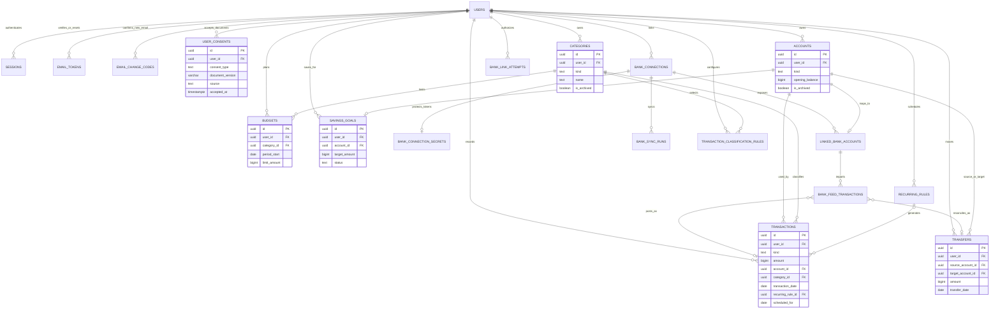

# Thiết kế cơ sở dữ liệu — PostgreSQL

Phần mở rộng role, dashboard thống kê Admin và nhật ký quản trị được đặc tả riêng tại [ADMIN_DATABASE_DESIGN.md](ADMIN_DATABASE_DESIGN.md). Migration 004 ghi nhận chấp thuận Điều khoản/Thông báo quyền riêng tư. Migration 005 thêm ảnh đại diện và OTP đổi email; migration 006 siết constraint hồ sơ. Migration 007 thêm consent riêng và attempt Hosted Link sandbox cho SePay Bank Hub; migration 008 bổ sung OTP xác minh email đăng ký; migration 009 bổ sung bộ vận hành Admin; migration 010 cho phép tùy chọn hiển thị USD và lưu lịch sử tỷ giá USD/VND; migration 011 lưu ngôn ngữ giao diện và dữ liệu cho quy trình đổi email hai bước.

Mô hình giao dịch nhập và phân loại P2 đầy đủ được đề xuất trong mục 3 bên dưới và [BANK_INTEGRATION_PLAN.md](BANK_INTEGRATION_PLAN.md). Mốc đang triển khai chọn SePay Bank Hub sandbox cho bước mở Hosted Link và xác nhận liên kết; chưa có import/sync giao dịch. Settings có catalog tĩnh 10 ngân hàng Bank Hub được công bố; backend chỉ nhận mã trong allowlist và từ chối ngân hàng không có tài khoản mẫu sandbox.

## 1. Phạm vi và nguyên tắc

- PostgreSQL 18; database local dự kiến `quan_ly_chi_tieu_dev`.
- PostgreSQL là nguồn dữ liệu chuẩn. Browser cache không thay thế DB và không được dùng để kiểm tra quyền.
- Mỗi bản ghi tài chính thuộc một user; truy vấn phải có `user_id`; composite foreign key ngăn liên kết chéo người dùng ngay cả khi API lỗi.
- Số tiền sổ cái lưu bằng `BIGINT` VND nguyên dương. Tùy chọn `users.currency` chỉ ảnh hưởng nhập/hiển thị và xuất báo cáo; API quy đổi USD sang VND ở backend trước khi ghi. Không dùng `REAL`/`DOUBLE PRECISION` cho tiền lưu trữ. Không hỗ trợ thấu chi ở phiên bản này.
- Thu/chi, transfer và mục tiêu là khái niệm riêng. Transfer giữa ví và nạp/rút goal không thành transaction income/expense.
- Số dư không lưu lặp; được tính từ số dư đầu kỳ + giao dịch + chuyển khoản.
- Xóa user xóa cascade dữ liệu của user. Tài khoản/danh mục/quy tắc có lịch sử được lưu trữ thay vì xóa cứng; lịch sử giao dịch được giữ.
- Thời gian nghiệp vụ giao dịch là `DATE`; thời điểm tạo/cập nhật/token/session là `TIMESTAMPTZ`.

## 2. ERD mức khái niệm



## 3. Bảng và ràng buộc

### `users`

| Cột | Ý nghĩa/ràng buộc |
|---|---|
| `id` | UUID PK |
| `email` | Email trình bày, không vượt quá 320 ký tự |
| `email_normalized` | Lowercase/trim ở service, duy nhất; tránh phụ thuộc extension `citext` |
| `full_name` | Tên 1–120 ký tự |
| `password_hash` | Hash scrypt do Node tạo; không lưu mật khẩu gốc |
| `email_verified_at` | NULL đến khi OTP xác minh (hoặc liên kết xác minh cũ còn hạn) được dùng thành công |
| `avatar_data` | Ảnh JPEG đã thu nhỏ, `BYTEA`, tối đa 256 KiB; trả qua route ảnh có xác thực |
| `avatar_mime` | `image/jpeg` khi có ảnh; cùng `avatar_data` và `avatar_updated_at` phải đồng null hoặc đồng có |
| `avatar_updated_at` | Thời điểm cập nhật ảnh; dùng tạo URL cache-busting, ảnh không lưu vào LocalStorage |
| `status` | `pending_email`, `active`, `disabled`; active bắt buộc đã verify |
| `currency` | Tùy chọn hiển thị `VND` hoặc `USD`; mặc định `VND`; thay đổi bởi migration 010 |
| `ui_language` | Ngôn ngữ giao diện `vi`, `en` hoặc `zh`; mặc định `vi`; thay đổi bởi migration 011 và API tùy chọn tài khoản |
| `timezone` | Mặc định `Asia/Ho_Chi_Minh` |

### `fx_rate_history` (migration 010)

- Lưu tỷ giá tham khảo chung do backend lấy từ CurrencyAPI; cặp được hỗ trợ là USD → VND. Chiều VND → USD được tính là nghịch đảo của cùng tỷ giá.
- Khóa chính `(provider, base_currency, quote_currency, rate_date)` giúp mỗi ngày chỉ có một bản ghi cho cặp/provider; có `provider_updated_at` và `fetched_at` để phân biệt thời gian dữ liệu với lần lấy về.
- Miễn phí cập nhật theo ngày. Máy chủ cache tối đa 23 giờ giữa các lần gọi, lưu lịch sử từ lúc tính năng được bật và từ chối ghi tiền USD nếu tỷ giá mới nhất cũ quá 72 giờ.
- API key chỉ ở `CURRENCYAPI_API_KEY` phía máy chủ, không nằm trong bảng, response, LocalStorage hay mã frontend.

### `sessions`

- Session ID UUID và `user_id` FK cascade.
- `token_hash BYTEA` duy nhất, đúng 32 byte (SHA-256); raw cookie token chỉ tồn tại ở browser/server memory.
- Có `created_at`, `last_seen_at`, `expires_at`, `revoked_at`; `expires_at > created_at`.
- Index theo `(user_id, expires_at)` và token hash để tra session nhanh.

### `registration_email_codes`

- Mỗi hàng gắn một `user_id`, hash scrypt có salt của OTP 6 chữ số, thời hạn, số lần thử, thời điểm dùng hoặc thu hồi.
- OTP được tự động gửi khi đăng ký; mã gốc chỉ được gửi qua SMTP, không trả về API, LocalStorage hay log. Hạn mặc định 10 phút (`EMAIL_OTP_TTL_MINUTES`, hợp lệ 1–30 phút), dùng một lần và khóa sau tối đa 5 lần nhập sai.
- Partial unique index giới hạn một mã chưa dùng/chưa thu hồi theo tài khoản. Chỉ cấp mã gửi lại khi mã trước hết hạn hoặc bị thu hồi do lỗi gửi/hết lượt thử; endpoint resend cũng có rate limit.
- Xác minh đúng sẽ kích hoạt user, tạo danh mục và tài khoản mặc định trong cùng transaction. SMTP lỗi làm thu hồi OTP để người dùng có thể yêu cầu gửi lại.

### `email_tokens`

- Lưu `user_id`, mục đích `verify_email` (chỉ phục vụ liên kết đã gửi trước khi chuyển sang OTP) hoặc `password_reset`, `token_hash` 32 byte, `expires_at`, `consumed_at`, `revoked_at`.
- Hash duy nhất; token hết hạn hoặc đã dùng/revoke không chấp nhận lại. Mỗi user/purpose chỉ có một token chưa consumed/revoked; service revoke token trước đó trước khi phát hành token mới.
- Liên kết xác minh cũ được giữ tương thích đến khi hết hạn; đăng ký mới dùng OTP. Không lưu token thô trong DB, log, URL analytics hay LocalStorage.

### `email_change_codes`

- Mỗi hàng gắn một `user_id`, email đích đã nhập và chuẩn hóa, hash scrypt có salt của mã 6 chữ số, thời hạn, số lần thử, thời điểm dùng hoặc thu hồi.
- Mã gốc chỉ được gửi qua SMTP, không trả về API, LocalStorage hay log. Mã hết hạn sau 10 phút mặc định (`EMAIL_OTP_TTL_MINUTES`, cấu hình hợp lệ 1–30 phút), chỉ dùng một lần và bị vô hiệu sau tối đa 5 lần nhập sai.
- Mã xác minh địa chỉ mới tham chiếu `authorization_id`; xác minh OTP chỉ đánh dấu mã mới đã được xác nhận, chưa thay email tài khoản. `updateProfile` chỉ thay địa chỉ sau khi người dùng bấm lưu và server kiểm tra lại mã, grant, email chưa được dùng trong cùng transaction.
- Nếu gửi email thất bại, mã bị thu hồi; gửi mã mới thu hồi mã đang chờ trước đó. Các endpoint yêu cầu session và có giới hạn tốc độ ở API.

### `email_change_authorization_codes` và `email_change_authorizations` (migration 011)

- Bước đầu gửi OTP 6 số đã băm tới email hiện tại đã xác minh. Bảng mã lưu email hiện tại chuẩn hóa, hash scrypt, hạn dùng, số lần thử, thời điểm dùng/thu hồi; chỉ có một mã đang hiệu lực cho mỗi user.
- OTP đúng được dùng một lần để tạo grant 15 phút trong `email_change_authorizations`, ràng buộc với email hiện tại. Grant chỉ cho phép gửi và xác nhận OTP ở email mới; grant không tự cập nhật email người dùng.
- Khi lưu hồ sơ, transaction khóa user, kiểm tra email đích chưa được dùng, grant còn hiệu lực và mã email mới đã xác minh; sau đó đổi email, đánh dấu xác minh và tiêu thụ grant/mã nguyên tử. Hủy luồng hoặc gửi OTP hiện tại mới sẽ thu hồi yêu cầu đang chờ.
- OTP/grant thô không trả về API, LocalStorage hay log. Các bảng có FK theo user và constraint expiry/attempt/terminal-state; endpoint có rate limit riêng.

### `user_consents`

| Cột | Ý nghĩa/ràng buộc |
|---|---|
| `id` | UUID PK |
| `user_id` | FK tới user; xóa user thì xóa bản ghi chấp thuận |
| `consent_type` | `terms_of_use` hoặc `privacy_notice` |
| `document_version` | Phiên bản tài liệu được người dùng chấp thuận; dạng `major.minor.patch` |
| `source` | `registration` hoặc `login`; server chỉ ghi sau khi kiểm tra hai lựa chọn và phiên bản |
| `accepted_at` | Thời điểm server ghi nhận, `TIMESTAMPTZ` |

Mỗi lần đăng ký/đăng nhập thành công tạo một bản ghi cho từng tài liệu. Không lưu mật khẩu, địa chỉ IP hay dữ liệu tài chính vào bảng chấp thuận. Frontend và backend phải dùng cùng số phiên bản; khi sửa nội dung, tăng phiên bản, cập nhật trang pháp lý và yêu cầu người dùng xác nhận lại.

### `accounts`

- Loại: `cash`, `bank`, `e_wallet`, `goal`; chỉ `goal` dùng nội bộ cho savings goal.
- `opening_balance BIGINT >= 0`, `name`, `icon_key`, màu hợp lệ và `is_archived`.
- Unique `(id,user_id)` và `(id,user_id,kind)` phục vụ composite FK. Tên active duy nhất không phân biệt hoa thường theo user.
- Không lưu `current_balance`; server/API tính số dư từ ledger.

### `categories`

- `kind` là `income` hoặc `expense`; category không thể bị giao dịch loại còn lại sử dụng nhờ composite FK.
- Tên, màu, icon, cờ `is_default`, `is_archived`; unique active `(user_id, kind, lower(name))`.
- Giao dịch/budget hiện có ngăn xóa cứng do FK; API thay bằng archive.
- Danh mục mặc định được seed theo từng user mới, không dùng một bản ghi chia sẻ giữa user.

### `recurring_rules`

- Có `kind`, `amount > 0`, `account_id`, `account_kind`, `category_id`, tiêu đề, `frequency` (`daily|weekly|monthly|yearly`), `start_on`, `end_on`, `next_occurrence_on`, `day_of_month` cho lịch tháng, `is_active`.
- Chỉ tham chiếu account thu/chi (`cash|bank|e_wallet`), category cùng loại và cùng user.
- `end_on` không trước `start_on`; ngày trong tháng từ 1–31; field ngày trong tháng chỉ dùng khi frequency là monthly.
- Rule đã tạo giao dịch được archive/tắt, không xóa để giữ lịch sử.

### `transactions`

- Chứa `income` hoặc `expense`, `amount > 0`, `transaction_date`, account, category cùng user/cùng loại, note tối đa 500 ký tự, timestamps.
- `account_kind` bị giới hạn `cash|bank|e_wallet`, vì vậy transaction thường không thể ghi trực tiếp vào goal account.
- `recurring_rule_id` và `scheduled_for` cùng NULL hoặc cùng có giá trị; `(recurring_rule_id, scheduled_for)` unique. Khi rule sinh cùng ngày lần nữa, DB ngăn bản ghi trùng.
- Account/category/rule tham chiếu bằng composite FK gồm `user_id` và discriminator cần thiết.
- Index theo `(user_id, transaction_date DESC)`, account/date và category/date.

### `transfers`

- Chứa user, account nguồn/đích, discriminator kind, số tiền > 0, ngày và note.
- Cả hai tài khoản phải cùng `user_id`; source khác target.
- Bảng riêng bảo đảm transfer không vào phép tổng income/expense. Goal contribution/withdrawal cũng là transfer.
- Server khóa account theo thứ tự ID và tính ledger trong một transaction trước khi ghi, để ngăn số dư âm và giảm race giữa mutation đồng thời.

### `budgets`

- `limit_amount > 0`, category chi phí cùng user, `period_start` phải là ngày đầu tháng.
- Unique `(user_id, category_id, period_start)`; chỉ một budget cho một category trong tháng.
- Chi đã dùng là tổng expense cùng user/category trong kỳ; transfer bị loại.

### `savings_goals`

- Một goal gắn một account có `kind='goal'` thông qua composite FK và `account_kind` hằng `goal`; một account goal chỉ có một goal.
- `target_amount > 0`, tên, ngày đích tùy chọn, trạng thái `active|achieved|archived`.
- Tiến độ hiện tại lấy từ số dư goal account; không ghi một `current_amount` cạnh tranh.
- Rút tiền kiểm tra số dư goal không âm trong DB transaction.

### Các bảng P2: kết nối ngân hàng và giao dịch nhập

Các bảng dưới đây là thiết kế mục tiêu; tất cả FK dùng thêm `user_id` để ngăn dữ liệu chéo user. Token/client secret chỉ có mặt khi provider được onboarding; không tạo fixture credential.

#### `bank_link_consents` — migration 007

- Mỗi lần bắt đầu flow ghi riêng `user_id`, `provider_code='sepay_bankhub'`, `bank_code`, `consent_version` và `accepted_at`.
- `UNIQUE (id,user_id)` cho FK có ownership. CHECK giới hạn provider, ngân hàng trong catalog và version semantic. Consent này không thay thế bản ghi Terms/Privacy ở `user_consents`.

#### `bank_link_attempts` — migration 007 (flow mở Hosted Link)

- Lưu consent, bank/provider code, SePay `provider_link_token_xid`, trạng thái (`ready|launched|linked|failed|expired|abandoned`), thời điểm và hạn dùng.
- Link Token và Hosted Link URL được mã hóa AES-256-GCM bằng key cấu hình ngoài PostgreSQL; Launch handle chỉ lưu SHA-256 hash. Raw handle nằm trong cookie HttpOnly một lần, không ở JSON.
- Ở `ready`, cần hai ciphertext và launch hash. Ở `launched`, Hosted Link URL ciphertext và launch hash phải bị xóa, Link Token ciphertext giữ lại để server hỏi trạng thái. Khi trạng thái cuối/expired, cả hai ciphertext bị xóa.
- Composite FK `(consent_id,user_id)` ngăn liên kết consent chéo user; unique provider Link Token XID; partial unique index giới hạn một attempt `ready|launched` trên mỗi user.
- Thành công hiện chỉ giữ tên ngân hàng và 4 số cuối; không có access token ngân hàng riêng, tài khoản liên kết hay feed transaction trong migration này.

#### `bank_connections`

- `id`, `user_id`, `provider_code` allowlist, `status` (`active|reauth_required|revoked|error`), `granted_scopes TEXT[]`, `consented_at`, `expires_at`, `revoked_at`, `last_synced_at`, timestamps.
- `UNIQUE (id,user_id)` cho composite FK từ tài khoản liên kết, sync run và credential.
- `revoked_at` chỉ có khi status `revoked`; không cho chạy sync khi trạng thái không active. Revoke ở ngân hàng/đối tác phải được gọi nếu API hỗ trợ.

#### `bank_connection_secrets`

- Một hàng cho connection: `connection_id`, `user_id`, `access_token_ciphertext`, `refresh_token_ciphertext`, `access_expires_at`, `refresh_expires_at`, `key_version`, `updated_at`.
- Ciphertext phải dùng AEAD (ví dụ AES-256-GCM); key nằm ở secret manager hoặc cấu hình bảo mật ngoài DB, có key rotation. Không lưu raw token.
- TPP `client_id/client_secret` là cấu hình của ứng dụng/provider trên server, không phải credential từng user và không lưu ở bảng này, `users`, log, response API hay LocalStorage.
- Composite PK/FK `(connection_id,user_id)` bảo đảm secret cùng chủ connection. Revoke phải xóa ciphertext theo chính sách, dù lịch sử feed được giữ.

#### `linked_bank_accounts`

- `id`, `user_id`, `connection_id`, `account_id`, `account_kind='bank'`, `external_account_ref_hash BYTEA`, `external_account_ref_ciphertext`, `external_ref_key_version`, `display_name`, `masked_account_number`, `currency='VND'`, `sync_cursor_ciphertext` tùy provider, `last_synced_at`, snapshot số dư và thời điểm lấy nếu API cung cấp.
- `UNIQUE (id,user_id)` để làm đích composite FK; FK `(connection_id,user_id)` tới `bank_connections`; FK `(account_id,user_id,account_kind)` tới `accounts`; `UNIQUE (connection_id,external_account_ref_hash)` và `UNIQUE (account_id)` để không map trùng một tài khoản nội bộ.
- Mã tài khoản ngoài cần dùng lại cho API phải mã hóa; HMAC-SHA-256 với key backend phục vụ unique lookup mà không để lộ số tài khoản. UI chỉ nhận tên và số tài khoản đã che. P2 ban đầu chỉ hỗ trợ tài khoản VND; số dư API (nếu có) là snapshot riêng, không ghi đè số dư ledger tính từ giao dịch.

#### `bank_sync_runs`

- `id`, `user_id`, `connection_id`, `mode` (`manual|scheduled|webhook`), `status` (`running|succeeded|partial|failed`), `started_at`, `finished_at`, `inserted_count`, `duplicate_count`, `error_code`, timestamps.
- `UNIQUE (id,user_id)` và composite FK `(connection_id,user_id)`; CHECK số đếm không âm và `finished_at >= started_at` khi đã kết thúc.
- Không lưu raw response, token, nội dung giao dịch hay stack trace. Lỗi người dùng nhận mã ổn định, log server chỉ giữ dữ liệu chẩn đoán đã lọc.

#### `transaction_classification_rules`

- `id`, `user_id`, `kind` (`income|expense`), `match_type` (`exact_reference|prefix_reference|contains_text`), `normalized_match_value`, `category_id`, `action` (`suggest|auto_apply`), `priority`, `is_active`, timestamps.
- `UNIQUE (id,user_id,kind)` và FK `(category_id,user_id,kind)` tới category cùng chủ và đúng loại; unique `(user_id,kind,match_type,normalized_match_value)`; giới hạn độ dài pattern và CHECK priority/range. Feed FK `(matched_rule_id,user_id,provisional_kind)` tham chiếu khóa này.
- `auto_apply` chỉ được phép với `exact_reference`; prefix/contains chỉ tạo gợi ý trong phiên bản đầu. Không dùng regex người dùng. Service vẫn từ chối tự áp dụng nếu match không duy nhất hoặc category đã lưu trữ.

#### `bank_feed_transactions`

- `id`, `user_id`, `linked_bank_account_id`, `first_seen_sync_run_id`, `external_transaction_key_hash BYTEA`, `external_transaction_key_ciphertext`, `external_key_version`, `direction` (`credit|debit`), `provisional_kind` (`income|expense`), `amount BIGINT > 0`, `currency CHAR(3)` mặc định `VND`, `transaction_date`, `description`, `reference_text`, counterparty đã che, `matched_rule_id`, `suggested_category_id`, `classification_status`, `posted_transaction_id`, `posted_transfer_id`, timestamps.
- `UNIQUE (id,user_id)` phục vụ composite FK; unique `(linked_bank_account_id,external_transaction_key_hash)` chống import trùng/retry. External transaction key được mã hóa để khôi phục khi cần, hash dùng HMAC-SHA-256; key version hỗ trợ luân chuyển key bằng cách rehash dữ liệu giải mã trước khi bỏ key cũ. Composite FK `(linked_bank_account_id,user_id)` và `(first_seen_sync_run_id,user_id)`; FK `(matched_rule_id,user_id,provisional_kind)` và `(suggested_category_id,user_id,provisional_kind)` bảo đảm rule/category cùng user và đúng loại; CHECK currency là VND trong P2 đầu tiên.
- Sau khi xử lý, mỗi feed item liên kết đúng một ledger record: `posted_transaction_id` XOR `posted_transfer_id`; FK `(posted_transaction_id,user_id)` tới `transactions(id,user_id)` và `(posted_transfer_id,user_id)` tới `transfers(id,user_id)` bảo đảm cùng user. `posted_transaction_id` unique; nhiều feed item (hai phía chuyển khoản) có thể trỏ tới cùng transfer nếu được ghép xác nhận. Ngoại lệ `potential_duplicate` được phép chưa có ledger link trong lúc chờ người dùng đối chiếu.
- `classification_status` gồm `needs_review|potential_duplicate|suggested|auto_classified|confirmed|reconciled_existing|transferred`; CHECK trạng thái khớp loại ledger posting. Bản ghi nguồn và mã hash được giữ để idempotency; số tiền/ngày/nội dung gốc không bị sửa khi user phân loại.
- Mỗi user có hai category hệ thống `Chưa phân loại` (income/expense). Cần thêm `categories.system_key` (`unclassified_income|unclassified_expense`) nullable, unique partial `(user_id,system_key)` và CHECK map đúng `kind`; migration backfill cho user hiện có, luồng tạo user seed cho user mới, DB/API không cho đổi tên/archive/delete category hệ thống. Migration phải preflight tên category trùng và dừng có hướng dẫn thay vì tự đổi category/dữ liệu của user.

#### Quy tắc ghi sổ và chuyển nội bộ

- `transfers` cần có `UNIQUE (id,user_id)` để feed có thể tham chiếu transfer đúng chủ; migration ngân hàng P2 007 trở lên thêm ràng buộc này nếu schema hiện tại chưa có.
- Sync tạo transaction ngay với chiều credit/debit tạm và category hệ thống Chưa phân loại; feed row trỏ tới transaction. Nhờ vậy số dư theo ledger được cập nhật đúng một lần dù người dùng chưa kịp phân loại. Trước khi tạo, lần sync đầu dò giao dịch thủ công có thể trùng theo account/date/amount/direction; nếu có ứng viên, tạm giữ feed ở `potential_duplicate` và yêu cầu user ghép với transaction cũ hoặc chọn import thêm. Không tự gộp chỉ vì số tiền/ngày giống nhau.
- Khi rule chính xác duy nhất `auto_apply` khớp, cùng DB transaction tạo feed row + transaction đã phân loại; ghi matched rule và `auto_classified`. User vẫn có thể đổi category sau đó.
- Khi user xác nhận một khoản là chuyển nội bộ, service khóa các account theo UUID ổn định, tạo transfer, chuyển liên kết feed sang transfer rồi xóa các transaction provisional trong cùng DB transaction. Không được để một phía còn nằm trong tổng income/expense.
- Nếu provider chỉ cung cấp một phía hoặc không đủ thông tin để nhận diện tài khoản đối ứng, giữ giao dịch tạm trong Chưa phân loại và cho user chọn account đối ứng; không tự suy đoán thành income/expense đã xác nhận.
- Danh mục Chưa phân loại làm phần chưa xử lý hiện rõ trong báo cáo và ngân sách; mọi màn hình thống kê tiếp tục dùng phương thức/logic JavaScript phía frontend phù hợp yêu cầu môn học.

## 4. Ma trận bảo đảm tính toàn vẹn

| Điều kiện | Lớp DB | Lớp service/API |
|---|---|---|
| Email chuẩn hóa không trùng | Unique `email_normalized`, check lowercase/trim | Chuẩn hóa, báo lỗi field email |
| Password/token không lưu thô | Cột password hash/token hash; độ dài hash | Scrypt; token ngẫu nhiên một lần; không log |
| Bản ghi tài chính thuộc user | FK user + composite FK `(id,user_id,...)` | Query luôn lọc session `user_id`; không tin ID từ client |
| Chấp thuận tài liệu có bằng chứng | FK user, CHECK loại/phiên bản/nguồn, thời điểm do DB ghi | Auth service chỉ thêm bản ghi sau khi server xác minh checkbox và phiên bản hiện hành |
| Amount là số nguyên VND dương | `BIGINT NOT NULL CHECK (amount > 0)` | Strict integer validation và format VND |
| Category cùng loại với transaction | Composite FK `(category_id,user_id,kind)` | Kiểm tra lỗi thân thiện trước write |
| Goal không dùng làm account giao dịch | Check `account_kind` loại thường + FK composite | Goal movement chỉ qua transfer |
| Budget tháng/category duy nhất | Unique `(user_id,category_id,period_start)` | Trả conflict cụ thể |
| Hai bên transfer khác nhau/cùng chủ | `CHECK source <> target`; 2 composite FK | Session ownership và balance check |
| Transfer/expense không làm số dư âm | Không thể bảo đảm bằng CHECK liên bảng | Lock row account; ledger calculate; transaction DB atomic |
| Recurring không sinh cùng ngày hai lần | Unique `(recurring_rule_id,scheduled_for)` | Insert idempotent và tiến lịch trong transaction |
| Goal rút không vượt số dư | Ledger và transaction lock | Khóa goal account, tính balance, trả 409 nếu thiếu |
| Lịch tháng hợp lệ | `CHECK day_of_month BETWEEN 1 AND 31` | Lịch tháng thiếu ngày được clamp về cuối tháng |
| Account/category đã dùng không xóa cứng | FK NO ACTION mặc định | API archive thay DELETE vật lý |
| Mỗi giao dịch bank ngoài chỉ nhập một lần | Unique `(linked_bank_account_id,external_transaction_key_hash)` | Upsert idempotent theo cursor và ID ngoài |
| Feed item và bút toán thuộc cùng user | Composite FK giữa connection/account/feed/transaction/transfer; thêm `UNIQUE (id,user_id)` cho transfers | Tất cả route lấy user_id từ session, không tin ID client |
| Rule chỉ dùng category đúng loại | Composite FK `(category_id,user_id,kind)` | Validation rule và kiểm tra category còn active |
| Token ngân hàng không lưu thô | Ciphertext, key version và key ngoài DB | Mã hóa AEAD, không ghi token vào log/response/cache |
| Feed đã import phản ánh đúng một lần vào ledger | XOR FK tới transaction hoặc transfer; ngoại lệ potential duplicate chờ đối chiếu; unique transaction link | Ghi đồng bộ trong một DB transaction; retry không cộng tiền lần nữa |
| Category Chưa phân loại không bị mất | `system_key` unique partial, check theo `kind`, trigger bảo vệ | Không cho rename/archive/delete qua API |

## 5. Tính số dư và ranh giới transaction

Cho account `A` tại thời điểm T:

```text
balance(A,T) = opening_balance(A)
             + sum(income on A through T)
             - sum(expense on A through T)
             + sum(transfers where A is target through T)
             - sum(transfers where A is source through T)
```

- Mọi amount là integer bigint; tổng hợp bằng PostgreSQL `SUM(BIGINT)` (trả numeric) hoặc JS `BigInt`/safe conversion có giới hạn rõ, không cộng bằng floating-point.
- Tạo/sửa/xóa expense, transfer hoặc contribution/withdrawal: khóa tất cả account chịu ảnh hưởng theo thứ tự UUID ổn định; tính số dư dưới cùng transaction; từ chối nếu tài khoản bị âm; ghi mutation; commit.
- Khi sửa transaction, tính lại với bản ghi cũ được loại khỏi ledger hoặc dùng delta đã tính chính xác.
- Báo cáo dùng `transaction_date`; transfer không được thêm vào thu/chi. Budget dùng [tháng bắt đầu, đầu tháng kế tiếp).
- Nếu xóa expense làm balance tăng thì vẫn cần cập nhật thống kê; xóa transfer cập nhật hai account nguyên tử.

## 6. Migration và seed

- `server/db/migrations/001_initial_schema.sql`: bảng, FK, CHECK, unique và index.
- `server/db/migrations/002_updated_at_triggers.sql`: trigger chuẩn hóa `updated_at` (cập nhật bởi DB) và hỗ trợ việc thêm constraint trigger nếu cần về sau.
- `server/db/migrations/003_admin_role_audit.sql`: role Admin và audit log; đã áp dụng theo trạng thái dự án.
- `server/db/migrations/004_legal_consents.sql`: bảng chấp thuận Điều khoản/Thông báo quyền riêng tư.
- `server/db/migrations/005_profile_avatar_email_otp.sql` và `006_profile_constraint_hardening.sql`: ảnh đại diện, đổi email có OTP và constraint hồ sơ.
- `server/db/migrations/007_bank_hub_link_flow.sql`: chấp thuận kết nối ngân hàng riêng và attempt SePay Hosted Link sandbox; chưa thêm linked accounts/feed/sync, không sửa migrations 001–006.
- `server/db/migrations/008_registration_email_otp.sql`: OTP đăng ký.
- `server/db/migrations/009_admin_operations_suite.sql`: công cụ vận hành Admin.
- `server/db/migrations/010_currency_and_fx_history.sql`: tùy chọn VND/USD và lịch sử tỷ giá.
- `server/db/migrations/011_ui_language_and_two_step_email_change.sql`: ngôn ngữ `users.ui_language` và bước xác minh email hiện tại/grant đổi email.
- Các bảng P2 còn lại (bank connections, linked accounts, sync runs, feed giao dịch, phân loại) vẫn là thiết kế mục tiêu; chỉ tạo migration mới sau khi chốt API sync, consent thu thập giao dịch, retention và luồng mapping tài khoản.
- Mỗi migration chạy trong transaction; không sửa migration đã áp dụng ở môi trường có dữ liệu, tạo migration version mới.
- `server/db/seed.sql`: seed categories mặc định cho một UUID user đã tồn tại, gọi bằng psql với biến `user_id`; không tạo tài khoản/password giả định và không seed dữ liệu tài chính cá nhân.
- Tạo migration ledger (`schema_migrations`) hoặc dùng runner có version; runner khóa migration và ghi version sau khi commit.

Ví dụ chạy bằng psql (sau khi local role/credential đã được cấu hình):

```powershell
psql -h 127.0.0.1 -p 5432 -U <database-user> -d quan_ly_chi_tieu_dev -f server/db/migrations/001_initial_schema.sql
psql -h 127.0.0.1 -p 5432 -U <database-user> -d quan_ly_chi_tieu_dev -f server/db/migrations/002_updated_at_triggers.sql
psql -h 127.0.0.1 -p 5432 -U <database-user> -d quan_ly_chi_tieu_dev -v user_id=<existing-user-uuid> -f server/db/seed.sql
```

Các placeholder trên không phải credential; không ghi password trong shell history, tài liệu hoặc Git. Cấu hình thật chỉ đặt trong `.env` local, `.env` được ignore.

## 7. Ma trận kiểm chứng ràng buộc trước khi dùng

Áp tất cả migration trên database rỗng, sau đó kiểm tra bằng transaction rollback hoặc fixture test có thể dọn an toàn:

1. Tạo 2 user có email khác chữ hoa/thường nhưng cùng địa chỉ đã normalize → lần hai bị từ chối.
2. Insert amount bằng 0 hoặc âm vào transaction, transfer, budget, goal → bị CHECK từ chối.
3. Dùng account/category của user B với `user_id` của user A → composite FK từ chối.
4. Dùng category expense cho transaction income (và ngược lại) → composite FK từ chối.
5. Tạo hai budget cùng user/category/tháng → unique từ chối; tháng có ngày đầu không phải mùng 1 → check từ chối.
6. Tạo transfer có source=target hoặc account khác user → CHECK/FK từ chối.
7. Tạo recurring transaction trùng `(rule_id,scheduled_for)` → unique từ chối; hai NULL của giao dịch không định kỳ vẫn được phép.
8. Tham chiếu goal account từ transaction/recurring expense → check/FK từ chối.
9. Tạo savings goal gắn account thường → composite FK từ chối; goal account trùng goal thứ hai → unique từ chối.
10. Token hash sai độ dài, session hết hạn trước lúc tạo, hoặc user active chưa xác minh → CHECK từ chối.
11. Thử rút goal/expense/transfer vượt ledger balance ở service trong hai request đồng thời → một mutation bị từ chối, không tạo số dư âm.
12. Xóa category/account/rule đang được dùng → bị FK chặn; archive qua API vẫn bảo toàn lịch sử.

Các mục 1–10 được kiểm bằng DDL trực tiếp; mục 11 thuộc service concurrency, mục 12 kiểm cả FK lẫn hành vi archive của API.

## 8. Kết quả kiểm chứng hiện tại

- Đã khởi tạo PostgreSQL 18 tạm trong `tmp/pg-check-20261014/` với trust authentication, chỉ để kiểm tra schema; không thay đổi cấu hình PostgreSQL đang chạy của máy.
- Hai migration áp dụng thành công trên database sạch; PostgreSQL tạo đủ bảng, index, triggers và ghi nhận version `001`, `002`.
- Fixture hai user chạy thành công. DDL đã từ chối đúng các vi phạm: email trùng sau chuẩn hóa, amount 0, account khác user, category sai loại, ngân sách trùng/tháng sai, transfer cùng account/chéo user, recurring cùng ngày bị sinh trùng, transaction trên goal account, goal gắn account thường và token hash sai độ dài.
- `updated_at` trigger đã được kiểm tra. Seed thêm 13 category mặc định cho user tồn tại; lần chạy thứ hai thêm 0 dòng; user UUID không tồn tại bị từ chối.
- Node API hiện đã được triển khai; 26 kiểm tra tích hợp trên PostgreSQL cô lập đã qua, gồm hai mutation cạnh tranh và rollback khi số dư âm. Migration chạy lại cũng bỏ qua đúng các phiên bản đã áp dụng.
- Lượt chạy ban đầu trên PostgreSQL local đã bỏ qua migrations 001–003 và áp dụng `004_legal_consents.sql`. Sau đó migrations 005–006 cũng đã áp dụng; snapshot ngày 16/10/2026 có 1 tài khoản active, 0 Admin và 2 bản ghi chấp thuận.
- SMTP verify/reset email và các auth/consent form chưa được nghiệm thu trực tiếp trên trình duyệt bằng email thật.


