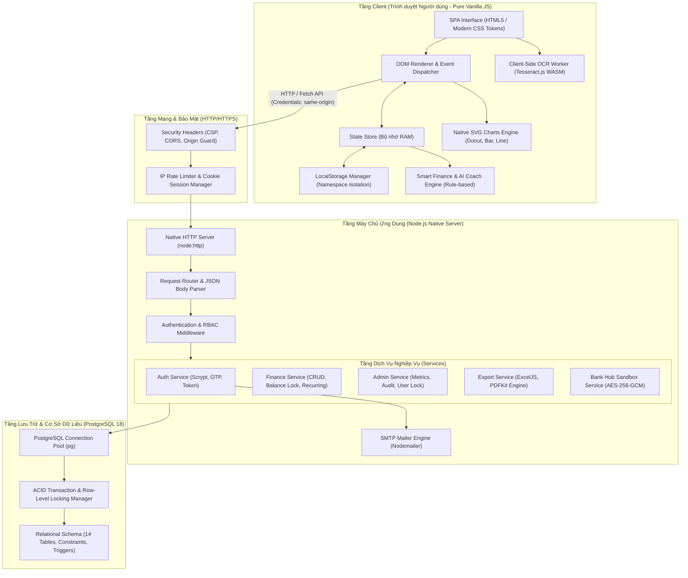
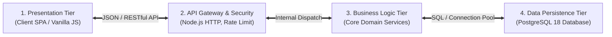
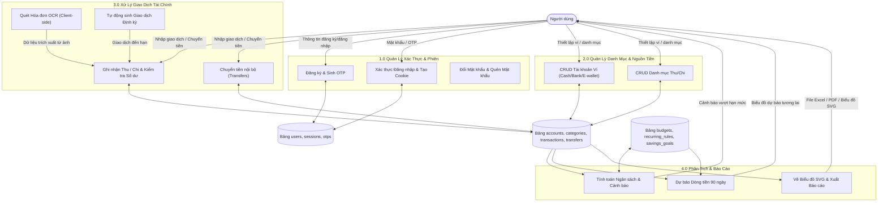
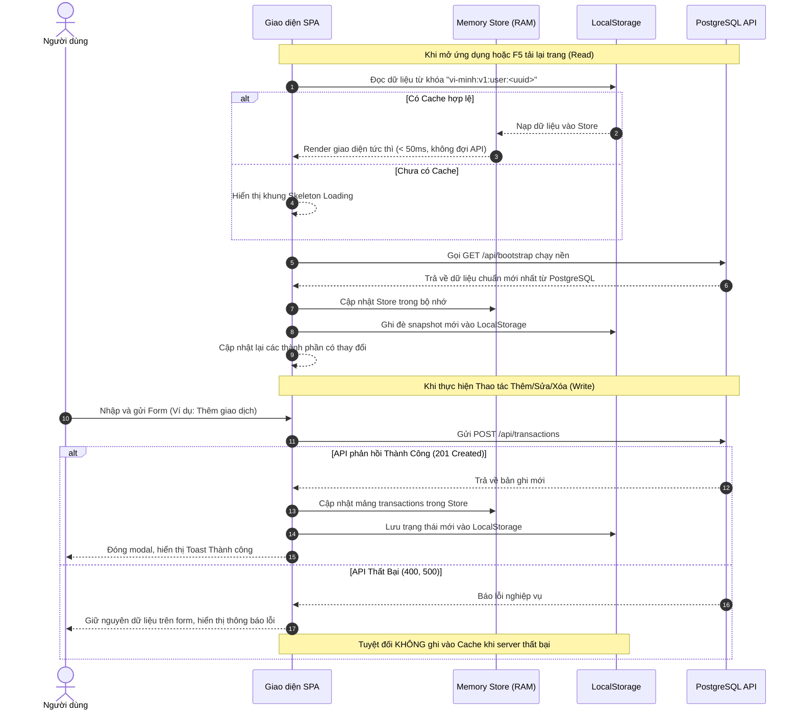
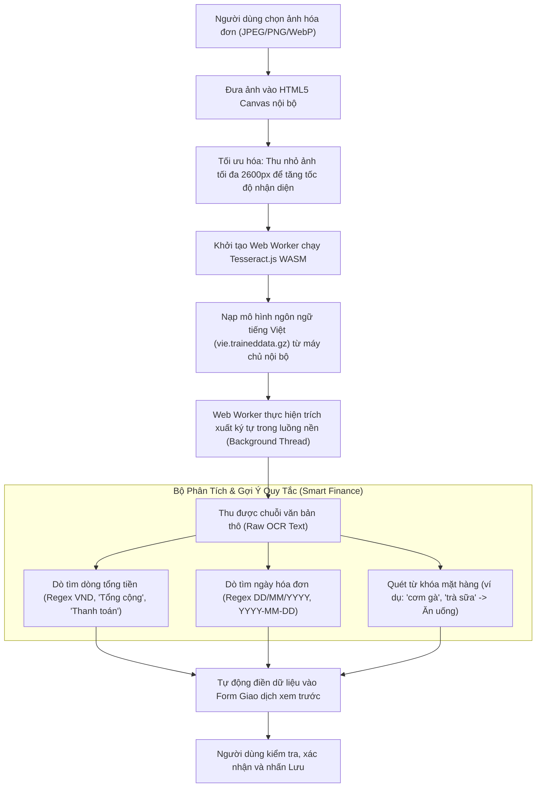
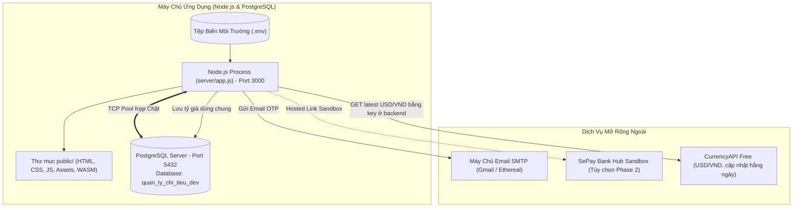

# Tài Liệu Thiết Kế Kiến Trúc Phần Mềm (Software Architecture Design Document)
## Dự án: Hệ Thống Quản Lý Chi Tiêu Cá Nhân — "Ví Mình"

---

## 1. Tổng Quan Kiến Trúc Hệ Thống (Architectural Overview)

### 1.1. Mục Tiêu Kiến Trúc
Hệ thống **Ví Mình** được thiết kế dựa trên các mục tiêu kiến trúc trọng tâm:
1. **Tuân thủ Tuyệt đối Chuẩn mực Môn học:** Giao diện sử dụng 100% **HTML5, CSS3 và Vanilla JavaScript ES6+**, không sử dụng bất kỳ UI framework, thư viện CRUD có sẵn hay thư viện vẽ biểu đồ nào. Toàn bộ logic giao diện, quản lý DOM, xử lý sự kiện và render SVG đều được tự phát triển.
2. **Hiệu Năng Cao & Trải Nghiệm Mượt Mà (SPA):** Ứng dụng hoạt động theo mô hình **Single Page Application (SPA)** kết hợp với chiến lược bộ nhớ đệm **Cache-First Read / Network-First Write**, đảm bảo tốc độ tải trang tức thì (< 50ms) và không có độ trễ giật lag khi chuyển đổi các màn hình.
3. **Bảo Mật & Tính Toàn Vẹn Tài Chính:** Backend được viết bằng **Node.js Native HTTP Server** (không Express), giao tiếp với cơ sở dữ liệu quan hệ **PostgreSQL 18** chuẩn ACID. Mọi giao dịch tài chính đều được thực thi trong Transaction độc lập, chống số dư âm, chống trùng lặp định kỳ và cách ly người dùng triệt để.
4. **Bảo Vệ Quyền Riêng Tư (Privacy-First):** Tính năng quét hóa đơn OCR được xử lý trực tiếp tại thiết bị người dùng (Client-Side WebAssembly), hình ảnh hóa đơn không tải lên máy chủ và không chuyển giao cho bất kỳ bên thứ ba nào.

---

### 1.2. Sơ Đồ Kiến Trúc Tổng Thể (High-Level Architecture Diagram)



---

## 2. Mô Hình Kiến Trúc Phân Tầng (Multi-Tier Architecture)

Hệ thống được tổ chức thành 4 phân tầng độc lập, có ranh giới trách nhiệm rõ ràng (Separation of Concerns):



### 2.1. Tầng Giao Diện Người Dùng (Presentation Tier - Client SPA)
- **Công nghệ:** HTML5, CSS3 thuần, JavaScript ES6+ Modules (`type="module"`).
- **Trách nhiệm:**
  - Định tuyến giao diện phía Client (View Router): chuyển đổi mượt mà giữa các trang (Dashboard, Giao dịch, Ví, Danh mục, Ngân sách, Định kỳ, Mục tiêu, Báo cáo, Quét hóa đơn, Quản trị Admin).
  - Quản lý DOM động: Tự động khởi tạo, cập nhật và dọn dẹp các phần tử HTML bằng DOM API (`createElement`, `appendChild`, `replaceChildren`, `addEventListener`).
  - Xử lý Form và Kiểm tra dữ liệu (Client-side Validation): Hiển thị thông báo lỗi tức thì cạnh từng ô nhập liệu trước khi gửi request lên máy chủ.
  - Quản lý Trạng thái (Reactive Store): Lưu giữ snapshot dữ liệu trong RAM và đồng bộ hóa với LocalStorage.
  - Vẽ đồ họa SVG thuần: Dựng biểu đồ tròn, cột, đường trực tiếp từ tọa độ toán học.

### 2.2. Tầng Cổng API & Bảo Mật (API Gateway & Security Layer)
- **Công nghệ:** `node:http`, `node:crypto`.
- **Trách nhiệm:**
  - Lắng nghe và tiếp nhận các kết nối HTTP.
  - Thực thi các bộ lọc bảo mật: Content-Security-Policy (CSP), X-Frame-Options (`DENY`), X-Content-Type-Options (`nosniff`).
  - Kiểm tra nguồn gốc yêu cầu (Origin / Referer Validation) trên mọi thao tác thay đổi dữ liệu nhằm ngăn chặn CSRF.
  - Áp dụng Rate Limiting theo từng Endpoint và IP để ngăn chặn tấn công dò quét mật khẩu và từ chối dịch vụ.
  - Kiểm tra và giải mã Cookie phiên `qlct_session`.

### 2.3. Tầng Xử Lý Nghiệp Vụ (Business Logic Tier - Services)
- **Công nghệ:** Pure Node.js Modules.
- **Trách nhiệm:**
  - **AuthService:** Đăng ký, băm mật khẩu Scrypt với salt ngẫu nhiên 16 bytes, sinh mã OTP 6 số, xác thực email, quản lý thu hồi phiên.
  - **FinanceService:** Xử lý toàn bộ logic tính toán số dư ví khả dụng, kiểm tra số dư không âm trước khi ghi nhận giao dịch chi, thực hiện chuyển tiền nguyên tử (Transfers), xử lý quy tắc định kỳ (Recurring Engine).
  - **AdminService:** Tập hợp số liệu thống kê toàn hệ thống, quản lý khóa/mở khóa người dùng, ghi nhận nhật ký kiểm toán (Audit Logging).
  - **ExportService:** Tạo luồng file Excel (.xlsx) thông qua ExcelJS và file PDF qua PDFKit với bảng biểu tự động chia trang.

### 2.4. Tầng Lưu Trữ & Cơ Sở Dữ Liệu (Data Persistence Tier)
- **Công nghệ:** PostgreSQL 18, `node-postgres` (`pg.Pool`).
- **Trách nhiệm:**
  - Duy trì kết nối hồ bơi (Connection Pooling) tối ưu hóa tài nguyên máy chủ.
  - Thực thi các truy vấn SQL có tham số (`$1, $2...`) phòng chống triệt để SQL Injection.
  - Quản lý giao dịch ACID (`BEGIN ... COMMIT / ROLLBACK`) và cơ chế khóa dòng (`FOR UPDATE`, `FOR SHARE`) đảm bảo tính nhất quán tuyệt đối của số dư tài chính.
  - Thi hành các ràng buộc Check Constraints và Foreign Key Cascades ở cấp độ CSDL.

---

## 3. Sơ Đồ Luồng Dữ Liệu (Data Flow Diagrams - DFD)

### 3.1. DFD Mức 0 (Context Diagram - Sơ Đồ Ngữ Cảnh)

```mermaid
flowchart TD
    User([Người Dùng Cá Nhân])
    Admin([Quản Trị Viên Admin])
    System[["Hệ Thống Ví Mình<br/>(Personal Finance Web App)"]]
    MailServer[("Hệ Thống Email SMTP")]
    DB[(Cơ Sở Dữ Liệu PostgreSQL)]

    User -- "1. Đăng ký, Đăng nhập, Quét hóa đơn OCR, Nhập giao dịch, Lập ngân sách" --> System
    System -- "2. Hiển thị Dashboard, Biểu đồ SVG, Cảnh báo ngân sách, Xuất báo cáo Excel/PDF" --> User

    Admin -- "3. Xem tổng quan hệ thống, Khóa/Mở tài khoản, Xuất nhật ký kiểm toán" --> System
    System -- "4. Hiển thị danh sách người dùng, Số liệu thống kê, Audit logs" --> Admin

    System -- "5. Gửi mã OTP xác minh đăng ký, Link đặt lại mật khẩu" --> MailServer
    System <==> "6. Đọc/Ghi dữ liệu tài chính chuẩn ACID" ==> DB
```

---

### 3.2. DFD Mức 1 (Detailed Data Flow Diagram)



---

## 4. Kiến Trúc Module Frontend (ES Modules Architecture)

Mã nguồn Frontend được chia tách thành các module chuyên biệt theo đúng chuẩn ES6 Modules:

```
public/js/
├── app.js                      # Controller trung tâm: Khởi tạo router, lắng nghe URL hash và nạp view
├── api/
│   ├── client.js               # Wrapper Fetch API cho toàn bộ API người dùng
│   ├── admin-client.js         # Wrapper Fetch API cho các endpoint quản trị Admin
│   └── download.js             # Tiện ích kích hoạt tải file nhị phân (Excel, PDF)
├── components/
│   ├── charts.js               # Động cơ tự vẽ biểu đồ SVG thuần (Donut, Bar, Line)
│   ├── toast.js                # Quản lý hiển thị Toast thông báo trạng thái
│   ├── icons.js                # Kho biểu tượng vector SVG nội bộ
│   └── custom-select.js        # Thành phần dropdown tùy biến giao diện
├── features/
│   ├── pages.js                # Render các trang chính (Dashboard, Giao dịch, Ví, Ngân sách,...)
│   ├── forms.js                # Quản lý hiển thị và submit các Modal form
│   ├── auth-view.js            # Điều khiển giao diện Đăng ký, Đăng nhập, OTP
│   ├── admin-view.js           # Điều khiển giao diện màn hình Quản trị Admin
│   ├── receipt-scanner.js      # Bộ điều khiển OCR quét hóa đơn tại trình duyệt
│   ├── ai-agent.js             # Giao diện hộp thoại tương tác AI Coach
│   └── bank-catalog.js         # Danh mục các ngân hàng hỗ trợ kết nối
├── state/
│   ├── store.js                # State Store lưu trữ dữ liệu trong bộ nhớ RAM
│   └── cache.js                # Bộ điều hợp LocalStorage có namespace theo từng User
└── utils/
    ├── dates.js                # Định dạng ngày tháng, tính toán chu kỳ tuần/tháng
    ├── money.js                # Định dạng tiền tệ VND, parse chuỗi số tiền
    ├── smart-finance.js        # Thuật toán dự báo 90 ngày, phát hiện trùng lặp, gợi ý danh mục
    └── validation.js           # Kiểm tra dữ liệu đầu vào phía Client
```

---

## 5. Chiến Lược Quản Lý Trạng Thái & Bộ Nhớ Đệm (State & Cache Strategy)

### 5.1. Cơ Chế Cache-First Read / Network-First Write
Để đạt được hiệu năng tối đa và tuân thủ yêu cầu bắt buộc của môn học về LocalStorage:



### 5.2. Nguyên Tắc An Toàn Bộ Nhớ Đệm (Cache Safety Rules)
- **Cô Lập Namespace:** Khóa cache được gắn tiền tố `vi-minh:v1:user:<user_id>`. Người dùng A đăng nhập trên cùng trình duyệt không bao giờ nhìn thấy dữ liệu của người dùng B.
- **Không Lưu Dữ Liệu Nhạy Cảm:** LocalStorage chỉ chứa dữ liệu phục vụ hiển thị (tên ví, số tiền, danh mục, giao dịch). Tuyệt đối **không** lưu mật khẩu, session token, mã OTP hay secret keys vào LocalStorage.
- **Dọn Dẹp Khi Đăng Xuất:** Khi người dùng nhấn Đăng xuất, toàn bộ dữ liệu tài chính trong Store và LocalStorage của tài khoản đó đều bị xóa sạch.

---

## 6. Động Cơ Tự Dựng Biểu Đồ SVG Thuần (Native SVG Charts Engine)

Hệ thống hoàn toàn **không sử dụng** bất kỳ thư viện biểu đồ bên ngoài nào (như Chart.js, Highcharts, D3.js). Thay vào đó, toàn bộ biểu đồ được tính toán bằng các thuật toán lượng giác và hình học thuần túy trong module `public/js/components/charts.js`:

### 6.1. Biểu Đồ Tròn Phân Bổ Danh Mục (Donut Chart)
- **Nguyên lý:** Nhận danh sách các danh mục và tổng tiền chi tương ứng.
- **Thuật toán:**
  1. Tính tổng chi tiêu: $S = \sum \text{amount}_i$.
  2. Tính góc quét của từng phần: $\alpha_i = \left(\frac{\text{amount}_i}{S}\right) \times 360^\circ$.
  3. Sử dụng công thức lượng giác tính tọa độ điểm đầu $(x_1, y_1)$ và điểm cuối $(x_2, y_2)$ trên đường tròn bán kính $R$:
     $$x = C_x + R \cdot \cos(\theta), \quad y = C_y + R \cdot \sin(\theta)$$
  4. Tạo phần tử hình cung bằng thẻ `<path>` SVG với cú pháp lệnh vẽ đường tròn:
     `d="M x1 y1 A R R 0 largeArcFlag 1 x2 y2"`.
  5. Khoét rỗng tâm để tạo hình Donut hiện đại, thêm tooltip tương tác khi rê chuột (`mouseenter`, `mouseleave`).

### 6.2. Biểu Đồ Cột So Sánh Thu Chi (Bar Chart)
- Nhận dữ liệu thu và chi theo từng tháng hoặc từng tuần.
- Tự động chuẩn hóa tỷ lệ chiều cao: $\text{height}_i = \left(\frac{\text{value}_i}{\text{max\_value}}\right) \times \text{chart\_height}$.
- Render các cặp thẻ `<rect>` đại diện cho Cột Thu (xanh lá) và Cột Chi (đỏ/coral) kèm lưới tọa độ `<line>` và nhãn trục `<text>`.

### 6.3. Biểu Đồ Đường Xu Hướng (Line Chart)
- Dựng đường biến thiên số dư qua thẻ `<polyline>` hoặc `<path>` mượt mà.
- Hiển thị các chấm tròn `<circle>` tại các mốc ngày có dữ liệu phát sinh.

---

## 7. Kiến Trúc Xử Lý OCR Client-Side Bảo Vệ Quyền Riêng Tư



---

## 8. Kiến Trúc Bảo Mật Toàn Diện (Security Architecture)

```mermaid
graph LR
    subgraph ClientProtection ["Bảo Vệ Phía Client"]
        XSSDef["Chống XSS: Tránh innerHTML, dùng textContent & Escape"]
        NoSecretLocal["LocalStorage an toàn: Không lưu Token/Mật khẩu"]
        CSPPolicy["Content Security Policy siết chặt"]
    end

    subgraph TransportProtection ["Bảo Vệ Đường Truyền"]
        TLS["HTTPS / TLS Encryption"]
        HttpOnlyCookie["Cookie HttpOnly, SameSite=Lax, Secure"]
    end

    subgraph ServerProtection ["Bảo Vệ Phía Server"]
        OriginCheck["Kiểm tra Header Origin/Referer chống CSRF"]
        ScryptHash["Băm mật khẩu Scrypt (Salt 16B, CPU/Memory Cost cao)"]
        RateLimit["Rate Limiter trong RAM chống Brute-force"]
        SQLParams["Tham số hóa 100% câu truy vấn (Parameterized SQL)"]
        RBAC["Kiểm soát truy cập dựa trên vai trò (RBAC User/Admin)"]
    end

    ClientProtection --> TransportProtection
    TransportProtection --> ServerProtection
```



1. **Phòng Chống Tấn Công SQL Injection:**
   - 100% câu lệnh truy vấn PostgreSQL trong thư mục `server/` đều sử dụng câu truy vấn có tham số (`$1, $2, ...`). Không bao giờ cộng chuỗi SQL trực tiếp.
2. **Phòng Chống Tấn Công XSS (Cross-Site Scripting):**
   - Không chèn chuỗi HTML từ người dùng trực tiếp qua `innerHTML`.
   - Sử dụng các hàm tạo nút DOM chuẩn (`document.createElement`) và gán nhãn qua `textContent`.
   - Cấu hình header `Content-Security-Policy` giới hạn tài nguyên chỉ nạp từ `'self'`.
3. **Phòng Chống Tấn Công CSRF (Cross-Site Request Forgery):**
   - Cookie phiên làm việc được cấu hình `SameSite=Lax` (hoặc `Strict` đối với các luồng liên kết nhạy cảm).
   - Kiểm tra `Origin` header trên toàn bộ các phương thức thay đổi trạng thái (`POST`, `PATCH`, `DELETE`).
4. **Kiểm Soát Truy Cập Phân Quyền (RBAC):**
   - Mọi API trong nhánh `/api/admin/*` đều kiểm tra `user.role === 'admin'`. Người dùng thường cố tình gọi API này sẽ nhận ngay mã phản hồi `403 Forbidden`.
   - Mỗi câu truy vấn dữ liệu tài chính đều kèm điều kiện `WHERE user_id = $1` để bảo đảm không người dùng nào xem được giao dịch của người khác.

---

## 9. Kiến Trúc Triển Khai & Vận Hành (Deployment Architecture)



### Quy Trình Vận Hành & Khởi Động:
1. Nạp và kiểm tra tính hợp lệ của biến môi trường (`validateRuntimeConfig`).
2. Khởi tạo kết nối hồ bơi PostgreSQL (`pool.js`).
3. Chạy tự động các migrations chưa áp dụng qua script `npm run db:migrate`.
4. Lắng nghe yêu cầu HTTP tại cổng cấu hình (mặc định `3000`).
5. Cung cấp cơ chế đóng máy chủ an toàn (Graceful Shutdown) khi nhận tín hiệu `SIGINT` / `SIGTERM`, tự động đóng các kết nối PostgreSQL trước khi thoát tiến trình.

### Tiền tệ hiển thị

- `users.currency` lưu tùy chọn giao diện `VND`/`USD`; tiền trong ledger vẫn là số nguyên VND.
- `server/services/fx-rate-service.js` lấy/cached tỷ giá USD/VND ở backend, lưu lịch sử trong `fx_rate_history`, và quy đổi payload USD trước các mutation tài chính. API key đến từ `.env` và không được gửi xuống browser.
- Frontend đổi cách nhập/hiển thị và dựng đồ thị tỷ giá bằng SVG thuần. CurrencyAPI Free cập nhật hằng ngày, vì vậy số liệu là tỷ giá tham khảo theo ngày, không phải realtime. Tham chiếu: [CurrencyAPI latest endpoint](https://currencyapi.com/docs/latest/).
