# Tài liệu Đặc tả Luồng Hoạt động (Workflow Specification)
## Dự án: Hệ Thống Quản Lý Chi Tiêu Cá Nhân — "Ví Mình"

---

## Mục lục
1. [Luồng 1: Đăng ký, Xác minh Email OTP & Khởi tạo Dữ liệu](#luồng-1-đăng-ký-xác-minh-email-otp--khởi-tạo-dữ-liệu)
2. [Luồng 2: Đăng nhập, Phiên Cookie HttpOnly & Đăng xuất](#luồng-2-đăng-nhập-phiên-cookie-httponly--đăng-xuất)
3. [Luồng 3: Quên mật khẩu & Đặt lại mật khẩu](#luồng-3-quên-mật-khẩu--đặt-lại-mật-khẩu)
4. [Luồng 4: Quản lý Hồ sơ cá nhân, Avatar & Đổi Email qua OTP](#luồng-4-quản-lý-hồ-sơ-cá-nhân-avatar--đổi-email-qua-otp)
5. [Luồng 5: Quản lý Ví & Tài khoản thanh toán (Accounts)](#luồng-5-quản-lý-ví--tài-khoản-thanh-toán-accounts)
6. [Luồng 6: Quản lý Danh mục Thu / Chi (Categories)](#luồng-6-quản-lý-danh-mục-thu--chi-categories)
7. [Luồng 7: Quản lý Giao dịch Thu / Chi (Transactions)](#luồng-7-quản-lý-giao-dịch-thu--chi-transactions)
8. [Luồng 8: Chuyển tiền nội bộ giữa các Ví (Transfers)](#luồng-8-chuyển-tiền-nội-bộ-giữa-các-ví-transfers)
9. [Luồng 9: Quản lý Ngân sách & Cảnh báo chi tiêu (Budgets)](#luồng-9-quản-lý-ngân-sách--cảnh-báo-chi-tiêu-budgets)
10. [Luồng 10: Giao dịch Định kỳ & Tự động sinh giao dịch (Recurring Rules)](#luồng-10-giao-dịch-định-kỳ--tự-động-sinh-giao-dịch-recurring-rules)
11. [Luồng 11: Quản lý Mục tiêu Tiết kiệm (Savings Goals)](#luồng-11-quản-lý-mục-tiêu-tiết-kiệm-savings-goals)
12. [Luồng 12: Dashboard Thống kê & Vẽ Biểu đồ SVG thuần](#luồng-12-dashboard-thống-kê--vẽ-biểu-đồ-svg-thuần)
13. [Luồng 13: Quét Hóa đơn Thông minh (Client-side OCR Receipt Scanner)](#luồng-13-quét-hóa-đơn-thông-minh-client-side-ocr-receipt-scanner)
14. [Luồng 14: Trợ lý Tài chính Cá nhân AI Coach & Cảnh báo](#luồng-14-trợ-lý-tài-chính-cá-nhân-ai-coach--cảnh-báo)
15. [Luồng 15: Dự báo Dòng tiền 90 ngày (Cashflow Forecasting)](#luồng-15-dự-báo-dòng-tiền-90-ngày-cashflow-forecasting)
16. [Luồng 16: Xuất Báo cáo Dữ liệu (Export Excel & PDF)](#luồng-16-xuất-báo-cáo-dữ-liệu-export-excel--pdf)
17. [Luồng 17: Quản trị Hệ thống dành cho Admin](#luồng-17-quản-trị-hệ-thống-dành-cho-admin)
18. [Luồng 18: Quản lý Trạng thái & Đồng bộ LocalStorage Cache](#luồng-18-quản-lý-trạng-thái--đồng-bộ-localstorage-cache)

---

## Luồng 1: Đăng ký, Xác minh Email OTP & Khởi tạo Dữ liệu

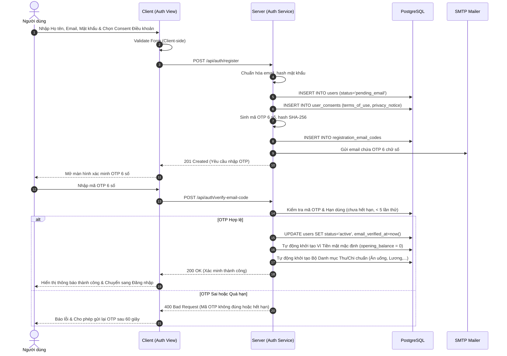

---

## Luồng 2: Đăng nhập, Phiên Cookie HttpOnly & Đăng xuất

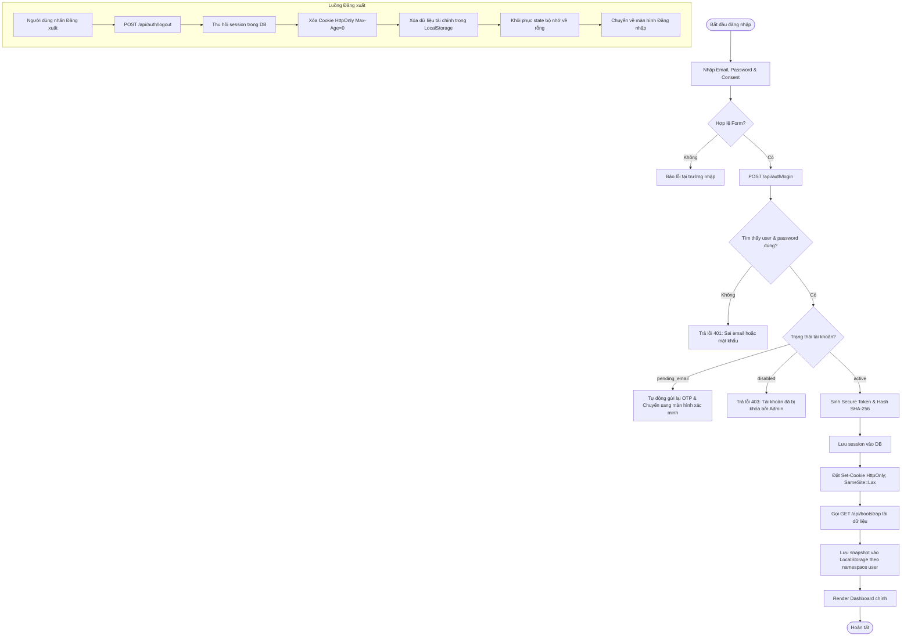

---

## Luồng 3: Quên mật khẩu & Đặt lại mật khẩu

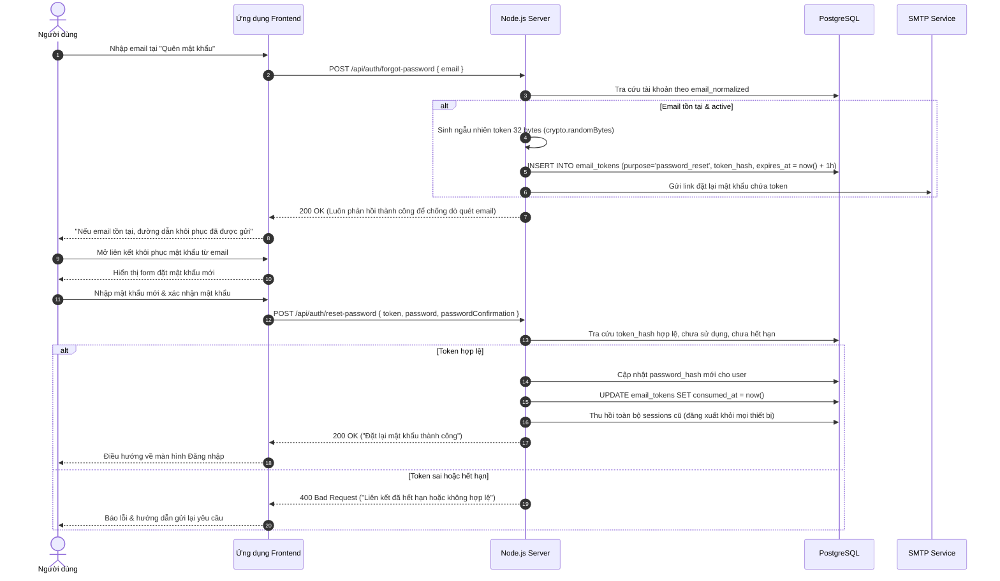

---

## Luồng 4: Quản lý Hồ sơ cá nhân, Avatar & Đổi Email qua OTP

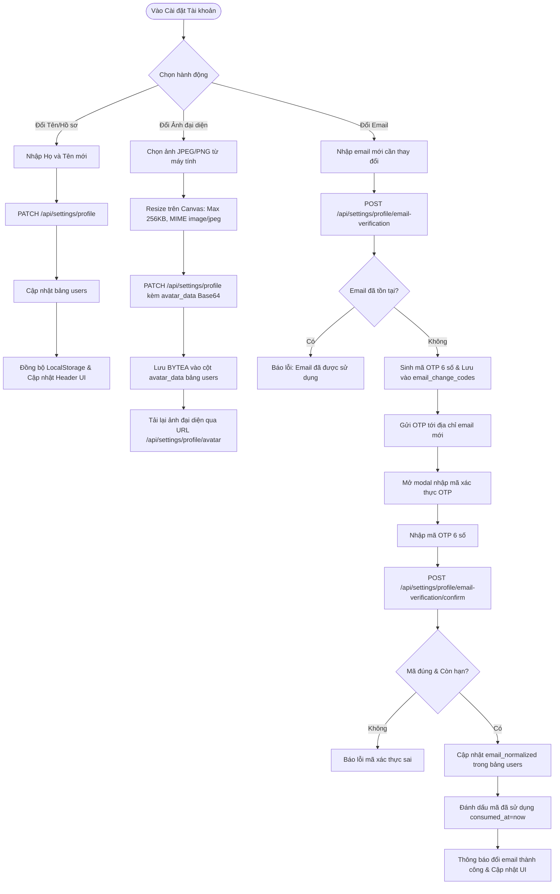

---

## Luồng 5: Quản lý Ví & Tài khoản thanh toán (Accounts)

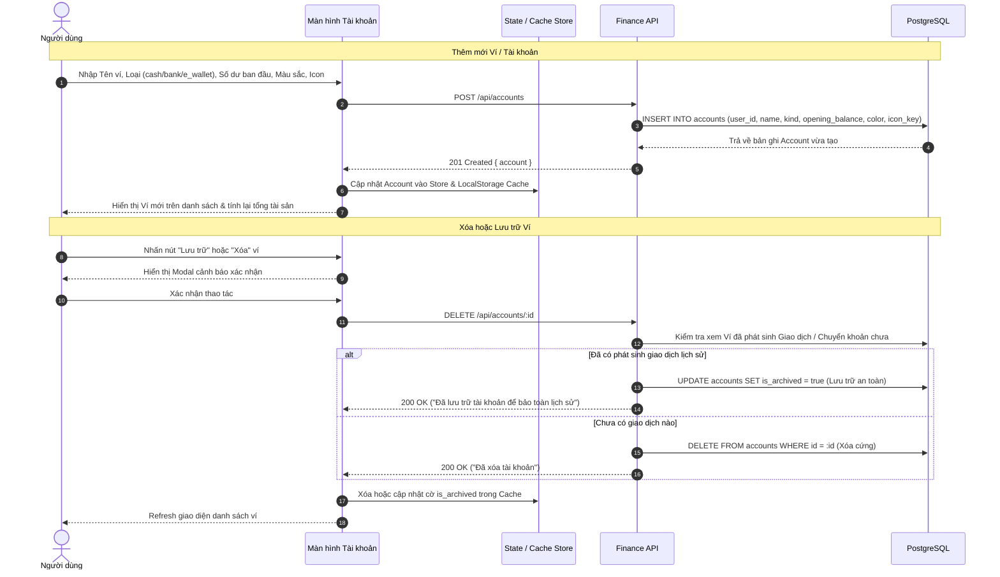

---

## Luồng 6: Quản lý Danh mục Thu / Chi (Categories)

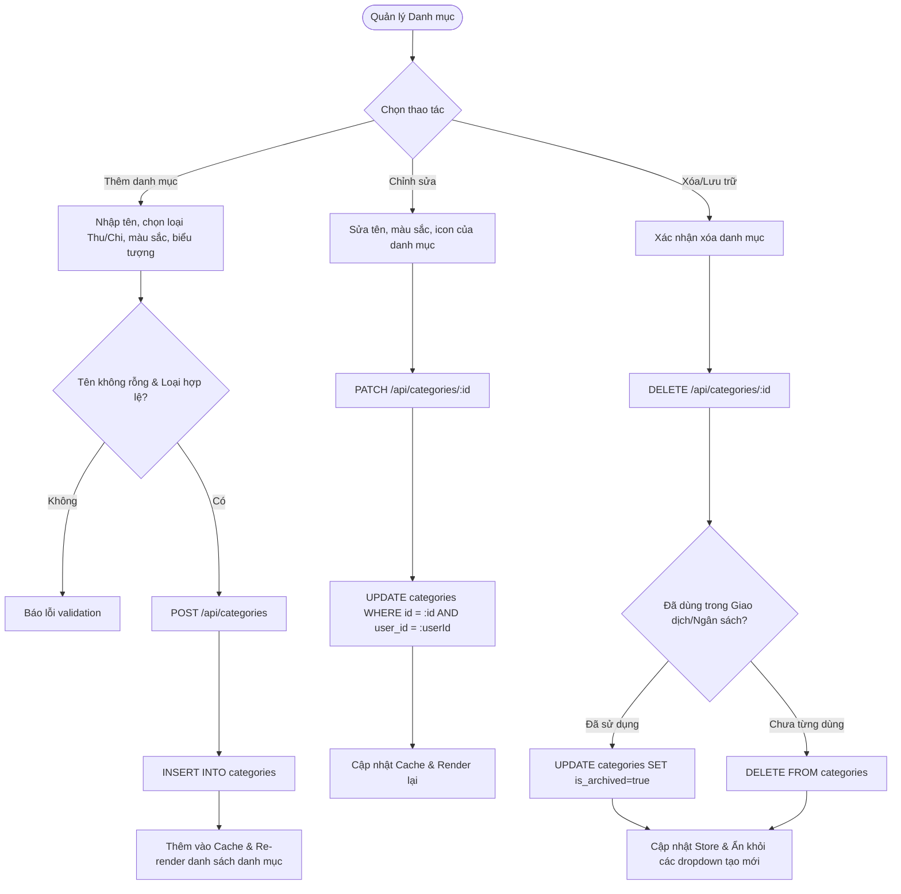

---

## Luồng 7: Quản lý Giao dịch Thu / Chi (Transactions)

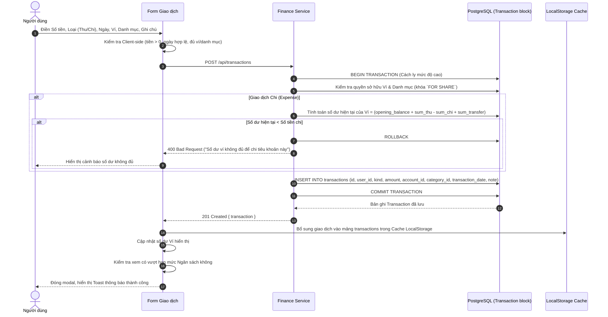

---

## Luồng 8: Chuyển tiền nội bộ giữa các Ví (Transfers)

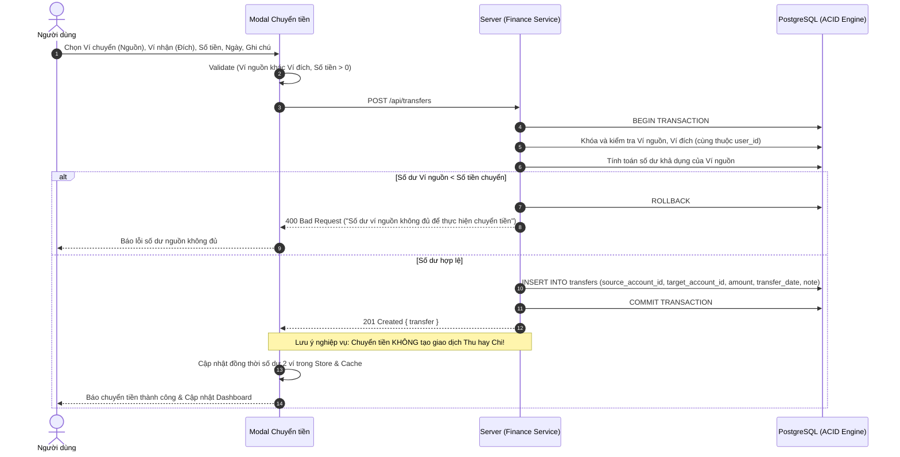

---

## Luồng 9: Quản lý Ngân sách & Cảnh báo chi tiêu (Budgets)

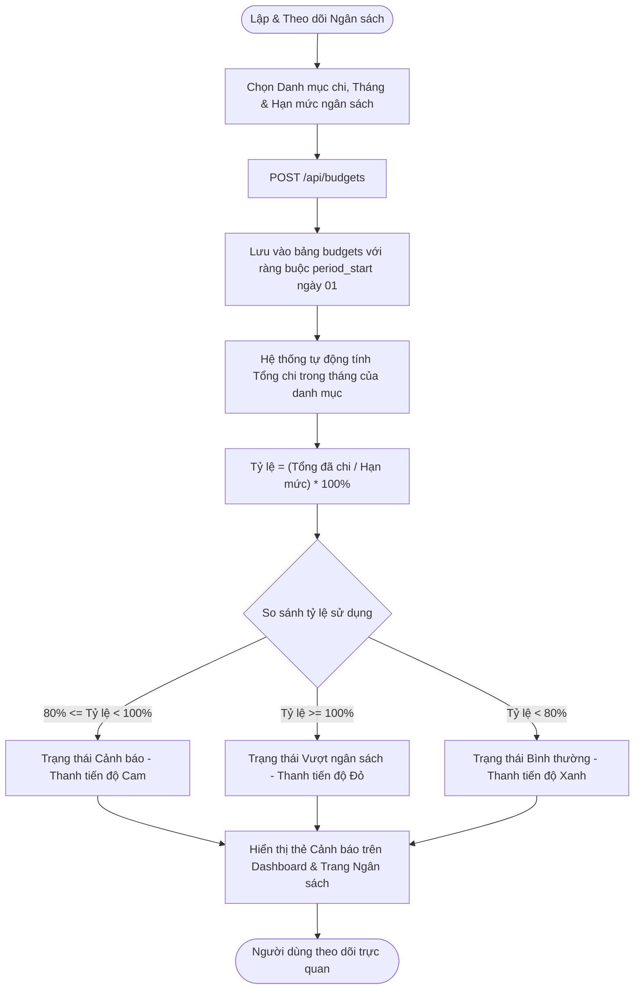

---

## Luồng 10: Giao dịch Định kỳ & Tự động sinh giao dịch (Recurring Rules)

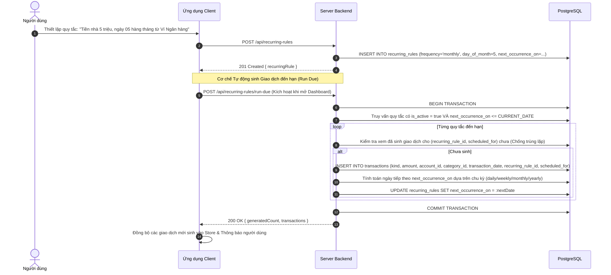

---

## Luồng 11: Quản lý Mục tiêu Tiết kiệm (Savings Goals)

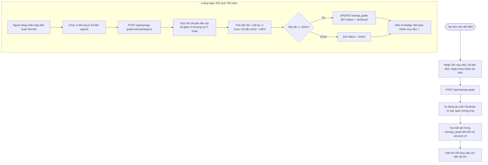

---

## Luồng 12: Dashboard Thống kê & Vẽ Biểu đồ SVG thuần

```mermaid
flowchart TD
    LoadPage([Vào trang Dashboard]) --> ReadCache[Đọc Snapshot từ LocalStorage Cache]
    ReadCache --> InitialRender[Render ngay số liệu & biểu đồ tạm thời để tránh nhấp nháy]
    InitialRender --> FetchAPI[Gọi GET /api/bootstrap hoặc /api/dashboard]
    FetchAPI --> SyncDBData[Nhận dữ liệu mới nhất từ PostgreSQL]
    SyncDBData --> OverwriteCache[Cập nhật lại LocalStorage Cache]

    subgraph Tính toán Số liệu Tài chính
        SyncDBData --> CalcKPI["Tổng thu = sum(Thu), Tổng chi = sum(Chi), Dòng tiền ròng = Thu - Chi"]
        SyncDBData --> FilterAccounts[Tính số dư từng ví & Tổng tài sản ròng]
        SyncDBData --> FilterBudgetAlerts[Lọc ngân sách vượt ngưỡng >= 80%]
    end

    subgraph Dựng Biểu đồ SVG thuần (Pure JS DOM)
        CalcKPI --> DonutChart["Tạo <svg> Donut: Tính tỷ lệ góc, vẽ <path> hình cung phân bổ danh mục"]
        CalcKPI --> BarChart["Tạo <svg> Cột: So sánh Thu vs Chi theo từng tháng"]
        CalcKPI --> LineChart["Tạo <svg> Đường: Vẽ đường biến thiên số dư/dòng tiền"]
    end

    DonutChart --> RenderDOM[Chèn các thẻ SVG trực tiếp vào container DOM]
    BarChart --> RenderDOM
    LineChart --> RenderDOM
    RenderDOM --> DoneDashboard([Dashboard hoàn chỉnh sẵn sàng tương tác])
```

---

## Luồng 13: Quét Hóa đơn Thông minh (Client-side OCR Receipt Scanner)

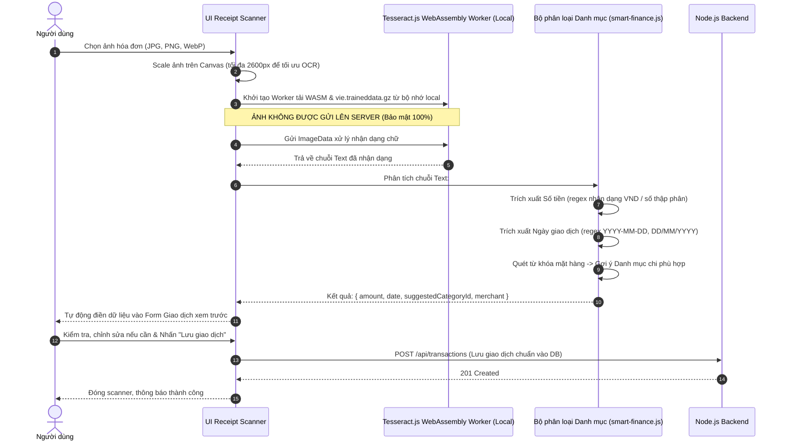

---

## Luồng 14: Trợ lý Tài chính Cá nhân AI Coach & Cảnh báo

```mermaid
flowchart TD
    UserQuery[Người dùng gõ câu hỏi vào AI Coach] --> ParseInput[Phân tích cú pháp ngôn ngữ tự nhiên tại Trình duyệt]
    ParseInput --> MatchIntent{Nhận diện Ý định (Intent)}

    MatchIntent -- "Chi tiêu / Thu nhập theo kỳ" --> ExecFinanceCalc[Lọc giao dịch theo ngày/tháng/danh mục từ Snapshot]
    MatchIntent -- "Kiểm tra giao dịch trùng" --> ExecDuplicateCheck[Dò tìm giao dịch chi trùng ngày, ví, danh mục, số tiền]
    MatchIntent -- "Dự báo dòng tiền" --> ExecForecast[Chạy thuật toán dự báo 90 ngày]
    MatchIntent -- "Tiến độ mục tiêu / Ngân sách" --> ExecProgressCheck[Đọc tiến độ các mục tiêu và ngân sách hiện hữu]

    ExecFinanceCalc --> BuildAnswer[Định dạng câu trả lời bằng tiếng Việt thân thiện]
    ExecDuplicateCheck --> BuildAnswer
    ExecForecast --> BuildAnswer
    ExecProgressCheck --> BuildAnswer

    BuildAnswer --> GenCTA[Sinh Nút Hành Động - Action CTA]
    GenCTA --> ExampleCTA["Ví dụ: Nút 'Xem giao dịch tháng 10' (tự điền bộ lọc ngày)"]
    ExampleCTA --> RenderChat[Hiển thị tin nhắn của AI Coach kèm CTA trong khung chat]
    RenderChat --> UserClickCTA[Người dùng nhấp CTA -> Điều hướng thẳng tới màn hình tương ứng]
```

---

## Luồng 15: Dự báo Dòng tiền 90 ngày (Cashflow Forecasting)

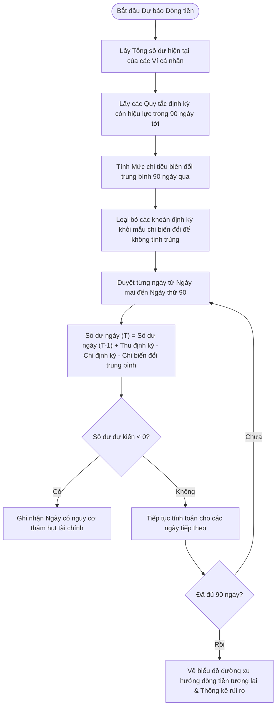

---

## Luồng 16: Xuất Báo cáo Dữ liệu (Export Excel & PDF)

```mermaid
sequenceDiagram
    autonumber
    actor User as Người dùng
    participant View as Trang Báo cáo
    participant Server as Server (Export Service)
    participant DB as PostgreSQL
    participant Lib as ExcelJS / PDFKit Engine

    User->>View: Chọn Khoảng thời gian (From - To) & Định dạng (.xlsx hoặc .pdf)
    View->>Server: GET /api/exports/user?dataset=transactions&format=xlsx&from=...&to=...
    Server->>Server: Xác thực phiên người dùng (HttpOnly Cookie)
    Server->>DB: Truy vấn dữ liệu: Thông tin User, Danh sách Giao dịch, Danh mục, Ví
    
    alt Định dạng Excel (.xlsx)
        Server->>Lib: Khởi tạo Workbook ExcelJS
        Lib->>Lib: Sheet 1 'Tổng quan': Thêm KPIs (Tổng thu, chi, chênh lệch) & Bảng thống kê danh mục
        Lib->>Lib: Sheet 2 'Giao dịch': Thêm bảng dữ liệu chi tiết (Loại, Số tiền, Ngày, Ví, Danh mục, Ghi chú)
        Lib->>Lib: Định dạng Header, Cột số tiền VND (#,##0 VND), viền bảng
        Lib-->>Server: Trả về Binary Buffer file .xlsx
    else Định dạng PDF (.pdf)
        Server->>Lib: Khởi tạo Document PDFKit (A4, font hỗ trợ tiếng Việt)
        Lib->>Lib: Vẽ Tiêu đề báo cáo, Thông tin người lập, Kỳ báo cáo
        Lib->>Lib: Vẽ Bảng tóm tắt tài chính & Vẽ bảng danh sách giao dịch tự động phân trang (Pagination)
        Lib-->>Server: Trả về Binary Buffer file .pdf
    end

    Server-->>View: 200 OK kèm Header Content-Disposition: attachment; filename="bao-cao-tai-chinh.xlsx"
    View-->>User: Kích hoạt tải file xuống máy tính của người dùng
```

---

## Luồng 17: Quản trị Hệ thống dành cho Admin

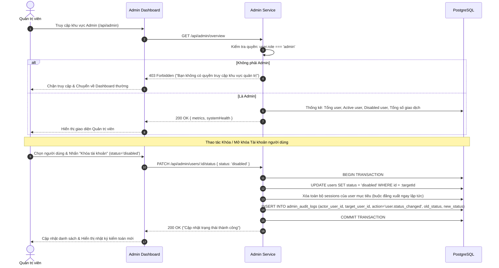

---

## Luồng 18: Quản lý Trạng thái & Đồng bộ LocalStorage Cache

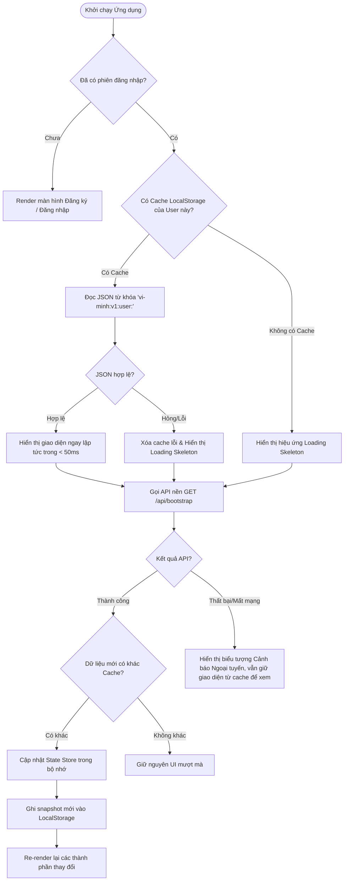

---

## Luồng 19: Chọn đơn vị hiển thị và theo dõi USD/VND

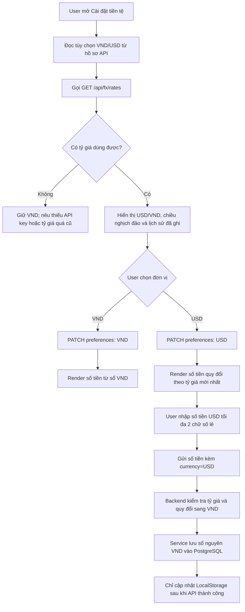

Tỷ giá gói miễn phí cập nhật theo ngày. Lịch sử biểu đồ được thu thập từ khi server bắt đầu lưu dữ liệu, không biểu diễn dữ liệu giả cho các ngày trước đó.
